

**[Download V0.025](#download)** · **[Supported controllers](#supported-controllers)** · **[Features](#features)** · **[PC mode](#pc-mode)** · **[Linux](#download)** · **[Troubleshooting](IF-YOUR-CONTROLLER-ISNT-WORKING.md)** · **[Changelog](CHANGELOG.md)**

> **V0.025 — Final release for now.** Open-source desktop controller studio for Windows (WPF + C++) and Linux (Avalonia) built for EasySMX gamepads — local-first, 100% offline assistant, no account, and no firmware flashing.

---

## Features

<table>
  <tr>
    <td width="50%" valign="top">
      
       <strong>RGB Studio &amp; Effects (X20 Pro)</strong> 
      4-zone live controller lighting, hex/palette swatches, Rainbow/Wave/Pulse/Battery effects, Screen Ambient Sync, and simultaneous 2.4 GHz dongle + unpaired BLE sync.
    </td>
    <td width="50%" valign="top">
      
       <strong>Live Lighting Engine</strong> 
      Trigger Glow, Stick Heat, Button Flash, Ambient Screen Sync, Cyberpunk/Fire/Police/Aurora presets, and battery-level gauges with safe BLE read-back.
    </td>
  </tr>
  <tr>
    <td width="50%" valign="top">
      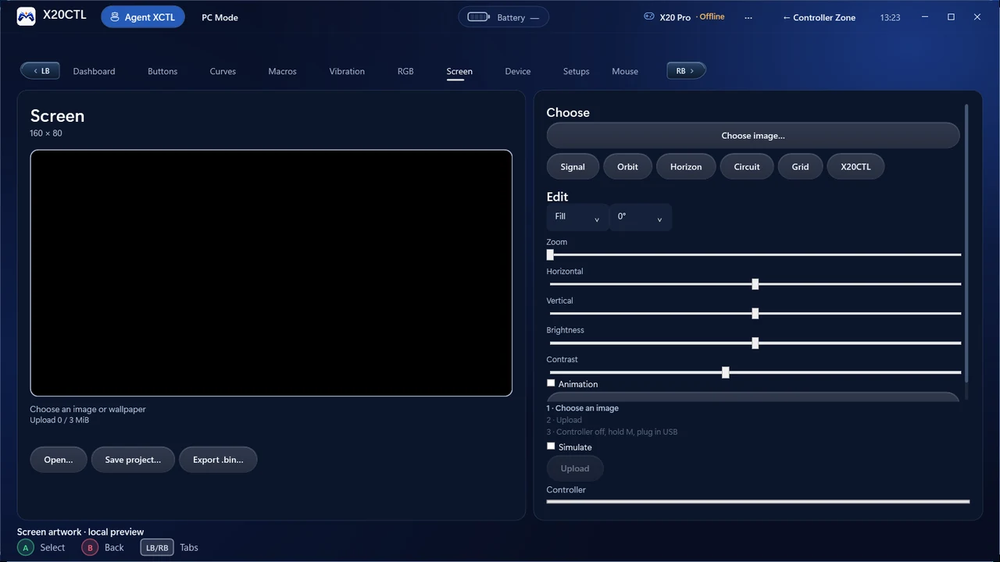
       <strong>Built-in Screen Editor (X20 Pro)</strong> 
      Upload static images or animated GIFs to the <code>160x80</code> controller display over USB serial, adjust crop/zoom/brightness/contrast, or export <code>.bin</code> artwork locally.
    </td>
    <td width="50%" valign="top">
      
       <strong>100% Offline Handheld Agent XCTL</strong> 
      Built-in handheld assistant wrapped in your chosen controller body: 3,048 phrases, Tab autocomplete, live Check-up, interactive RGB cards, help search, and multi-step undo with zero external AI calls.
    </td>
  </tr>
  <tr>
    <td width="50%" valign="top">
      
       <strong>Buttons &amp; Macros</strong> 
      Interactive front/rear visualizer with listen-to-bind capture, draft previews, saved setups, and sequence macro timelines on hardware slots (<code>M1–M4</code> / <code>M1–M6</code>).
    </td>
    <td width="50%" valign="top">
      
       <strong>Stick &amp; Trigger Curves</strong> 
      Sculpt response curves with built-in presets (Default, Quick, Slow, Smooth, Fine), inner/outer dead zones, keyboard curve testing, and one-click Diagnostics drift setup.
    </td>
  </tr>
  <tr>
    <td width="50%" valign="top">
      
       <strong>Keyboard &amp; Custom Key Sequences</strong> 
      Bind controller buttons to real keyboard keys or mouse buttons (<code>M1–M7</code>), or play up to 64 keys with per-step hold/pause timings inside PC Mode.
    </td>
    <td width="50%" valign="top">
      
       <strong>Controller as Mouse</strong> 
      Move the cursor, scroll horizontally/vertically, bind <code>M1–M7</code> + turbo (2–30 Hz), and toggle mouse mode anytime with <code>View + Y</code>.
    </td>
  </tr>
  <tr>
    <td width="50%" valign="top">
      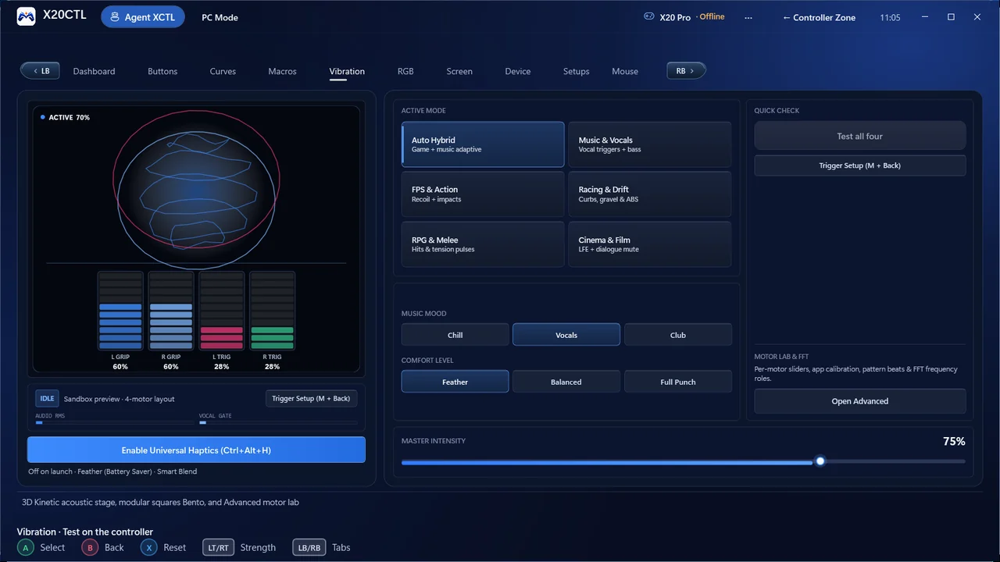
       <strong>4-Zone Vibration &amp; 200% Boost</strong> 
      Independent sliders and isolated tests for left/right grip and trigger motors, plus PC Mode game-rumble amplification up to 200%.
    </td>
    <td width="50%" valign="top">
      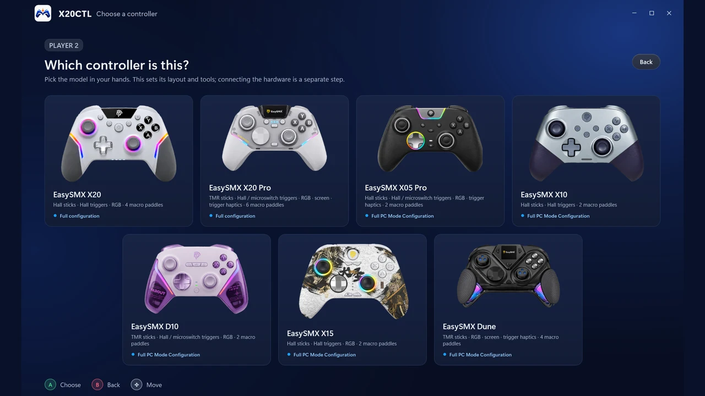
       <strong>7 EasySMX Models &amp; Finish Packs</strong> 
      Full hardware artwork, rear views, and colourways across X20, X20 Pro, X15, X10, X05 Pro, D10, and Dune 8K.
    </td>
  </tr>
</table>

<strong>More Studio screens</strong> — Zone, Dashboard, Agent Check-up, Macros, Tester, Diagnostics, Controller Check, Tools &amp; Linux Studio

<table>
  <tr>
    <td width="50%">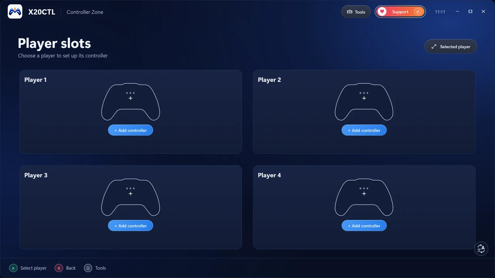 <b>Controller Zone</b> — 4-player slots &amp; hot-swap studio</td>
    <td width="50%">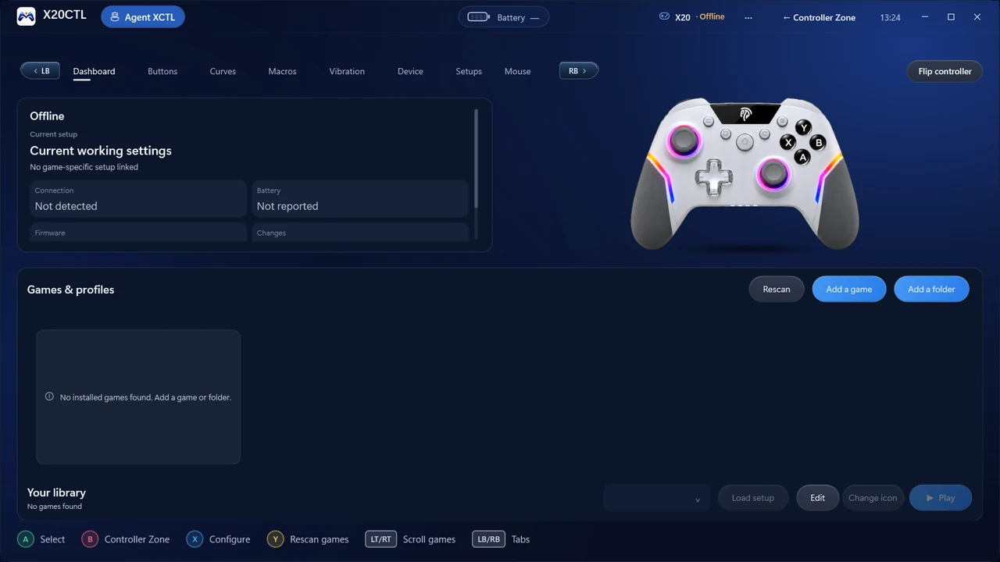 <b>Dashboard</b> — Steam/Epic/GOG/Riot per-game profiles</td>
  </tr>
  <tr>
    <td width="50%">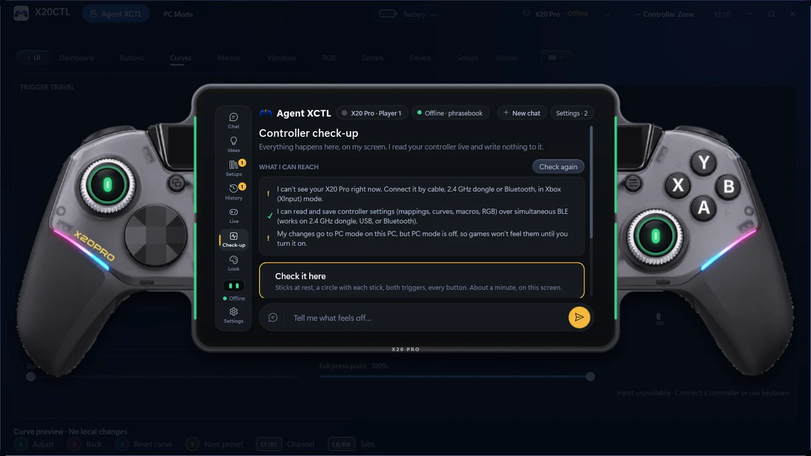 <b>Agent Check-up</b> — stick drift, range &amp; link audit</td>
    <td width="50%">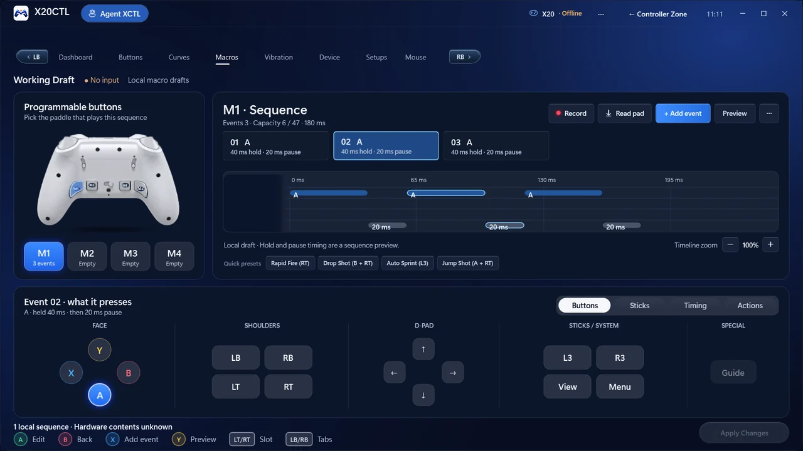 <b>Macros</b> — rear paddle sequences &amp; visual timeline</td>
  </tr>
  <tr>
    <td width="50%">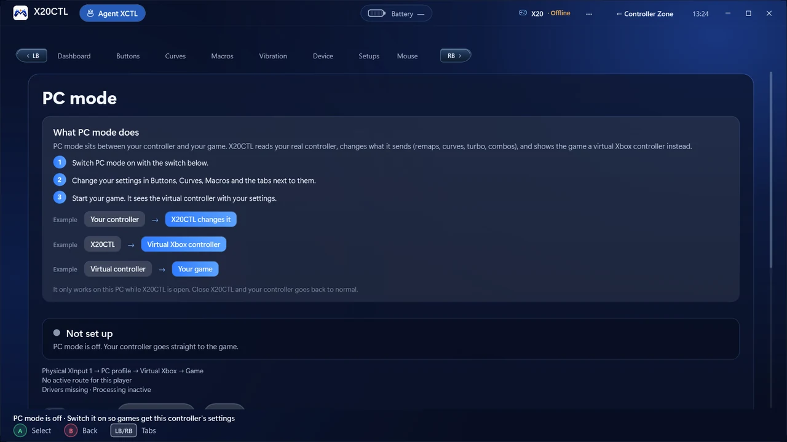 <b>PC Mode</b> — virtual Xbox 360 / DualShock 4 pipeline</td>
    <td width="50%">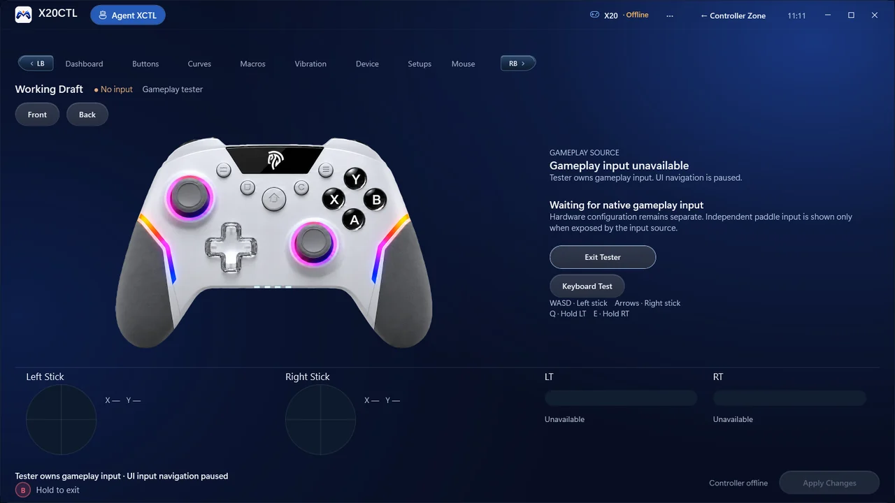 <b>Tester</b> — live XInput &amp; keyboard test overlay</td>
  </tr>
  <tr>
    <td width="50%"> <b>Diagnostics</b> — raw stick resolution &amp; update rate</td>
    <td width="50%"> <b>Controller Check</b> — read-only hardware capture</td>
  </tr>
  <tr>
    <td width="50%">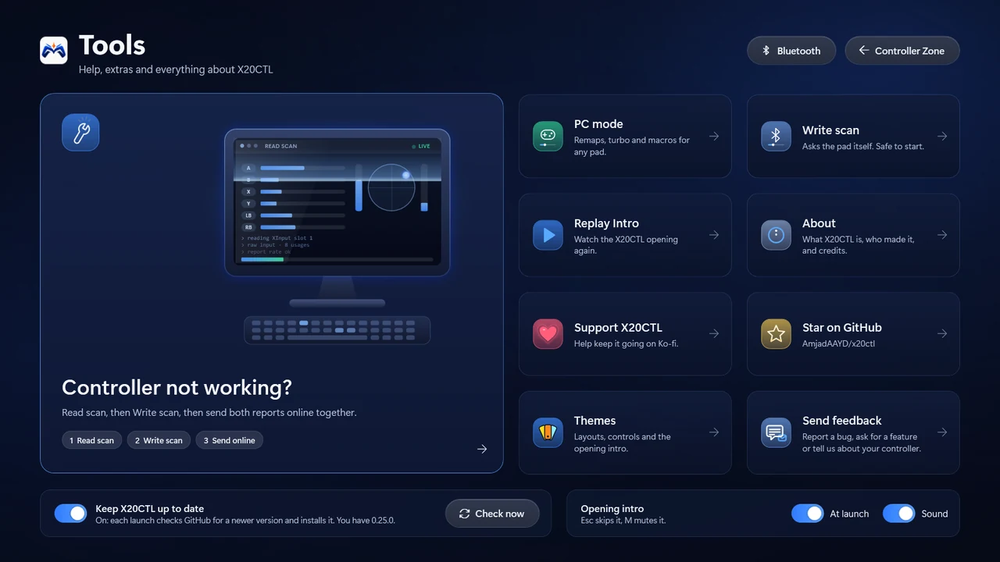 <b>Tools</b> — Bluetooth manager, themes &amp; update controls</td>
    <td width="50%"> <b>Linux Studio</b> — Avalonia desktop interface</td>
  </tr>
</table>

 

  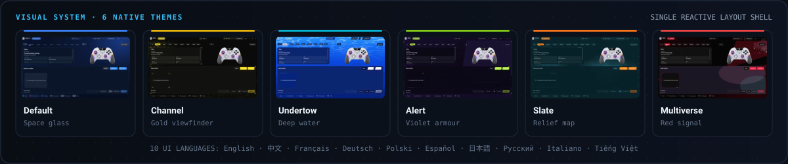

---

## Supported controllers

Every model runs local drafts and **PC Mode**. Hardware flash configuration depends on each controller's verified protocol:

| Controller | On-device configuration | PC Mode | Notes |
|---|---|---|---|
| **EasySMX X20** | Buttons, curves, macros (`M1–M4`), vibration | Yes | Full BLE GATT configuration + read-back verification |
| **EasySMX X20 Pro** | Buttons, curves, macros (`M1–M6`), 4-motor vibration, RGB Studio, `160x80` screen | Yes | Simultaneous 2.4 GHz dongle (`413D:2131`) + unpaired BLE when PC Bluetooth is on |
| **EasySMX X15** | Read-only in Studio | Yes | Windows/Linux PC Mode remapping, curves, keyboard, mouse, rumble |
| **EasySMX X10** | Experimental read-only Bluetooth (KRLY) | Yes | BLE read-back ported from EasyGamepad; awaiting physical X10 verification |
| **EasySMX X05 Pro** | Read-only in Studio | Yes | DInput recognition helper in Write scan (`tools`) |
| **EasySMX D10** | Read-only in Studio | Yes | Full PC Mode profiles, curves, keyboard &amp; mouse |
| **EasySMX Dune 8K** | Layout &amp; 4-motor haptic visualizer | Yes | `M1–M4` layout &amp; trigger rumble in PC Mode; native BLE/USB protocol unverified |

- **Dongle / DInput tip (`0079:181C` / Steam `STK-7024X`):** If your X20 Pro or X20 connects in DInput mode (`STK-7024X`), switch the physical controller back to XInput mode for full PC Mode and dongle+BLE recognition. See [`IF-YOUR-CONTROLLER-ISNT-WORKING.md`](IF-YOUR-CONTROLLER-ISNT-WORKING.md).
- **10 UI Languages:** Switch between English, 中文, Français, Deutsch, Polski, Español, 日本語, Русский, Italiano, and Tiếng Việt in **Tools -> Themes**.

  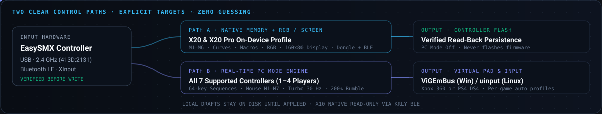

---

## PC mode

**PC Mode** sits cleanly between your controller and your games, applying remaps, response curves, keyboard/mouse bindings, turbo (`0–30 Hz`), and up to `200%` game rumble amplification while active — closing X20CTL restores your pad immediately.

- **Windows output:** Pinned, SHA-256 verified [`ViGEmBus` (`1.22.0`)](https://github.com/nefarius/ViGEmBus) and [`HidHide` (`1.5.230`)](https://github.com/nefarius/HidHide), offering selectable **Xbox 360** or **PlayStation 4 (DualShock 4)** virtual controllers across **up to 4 players**.
- **Per-game automatic switching:** Detects local Steam, Epic, GOG, and Riot titles on Windows (Steam, Heroic, and Lutris on Linux) to load setups automatically when launched.
- **On-pad toggle:** Hold **View + Menu** to toggle PC Mode, or **View + Y** to toggle Mouse mode, without leaving your game.
- **Linux output:** Exclusive `evdev` source routing (`EVIOCGRAB`) and virtual Xbox 360 output via `/dev/uinput` (`60-x20ctl-uinput.rules` setup instructions shown in-app; see [`docs/linux-user-guide.md`](docs/linux-user-guide.md)).

---

## Controller Check

**Controller Check** (under **Tools**) inspects how Windows or Linux actually sees your controller without writing to hardware memory:

- **Read scan:** Guided per-control check recording buttons, stick resolution/center drift, trigger range, and report timing into a local ZIP.
- **Write scan:** Identifies whether a Bluetooth pad answers like X20 or X20 Pro and lets you run read-only record read-back checks before ever consenting to a reversible write test.
- **Safe mismatch handling:** If Windows detects another EasySMX model than you clicked, X20CTL clearly offers **Enter Studio as \<detected\>**, **Continue as \<chosen\>**, or **Cancel**, while native BLE writes still verify hardware identity before writing.

---

## Tools

- **6 Native Themes &amp; 10 Languages:** Switch themes (`Default`, `Channel`, `Undertow`, `Alert`, `Slate`, `Multiverse`) and UI languages live.
- **Bluetooth Manager:** Scan, pair, connect, and inspect nearby BLE controllers directly from Tools or offline screens.
- **Updates (`Keep X20CTL up to date`):** On by default; checks stable GitHub releases only (skips pre-releases) and verifies downloads against `SHA256SUMS.txt`. Toggle off anytime.
- **Tray &amp; Preferences:** Minimizing/closing can keep active PC Mode profiles running in the system tray (right-click tray icon -> **Quit** to exit completely). Opening intro video &amp; sound can also be toggled cleanly in Tools.

---

## Download

All official builds are compiled from source via GitHub Actions on [**Release V0.025**](https://github.com/AmjadAAYD/x20ctl/releases/tag/v0.025) and checksummed in [`SHA256SUMS.txt`](https://github.com/AmjadAAYD/x20ctl/releases/download/v0.025/SHA256SUMS.txt).

| Platform | Package | Download | Notes |
|---|---|---|---|
| **Windows 10/11 (x64)** | Installer (Recommended) | [`X20CTL-V0.025-windows-x64-setup.exe`](https://github.com/AmjadAAYD/x20ctl/releases/download/v0.025/X20CTL-V0.025-windows-x64-setup.exe) | Bundled .NET 10 + C++ engine + Start menu |
| **Windows 10/11 (x64)** | Portable Single Exe | [`X20CTL-V0.025-windows-x64.exe`](https://github.com/AmjadAAYD/x20ctl/releases/download/v0.025/X20CTL-V0.025-windows-x64.exe) | No installer; unpacks engine to temp folder |
| **Linux (x86_64)** | AppImage | [`X20CTL-V0.025-linux-x86_64.AppImage`](https://github.com/AmjadAAYD/x20ctl/releases/download/v0.025/X20CTL-V0.025-linux-x86_64.AppImage) | Self-updating against `SHA256SUMS.txt` |
| **Linux (x86_64)** | Flatpak Bundle | [`X20CTL-V0.025-linux-x86_64.flatpak`](https://github.com/AmjadAAYD/x20ctl/releases/download/v0.025/X20CTL-V0.025-linux-x86_64.flatpak) | Install with `flatpak install --user` |
| **Linux (glibc x64)** | Tarball | [`X20CTL-V0.025-linux-x64.tar.gz`](https://github.com/AmjadAAYD/x20ctl/releases/download/v0.025/X20CTL-V0.025-linux-x64.tar.gz) | Ubuntu, Fedora, Arch, Debian, openSUSE |
| **Linux (musl x64)** | Tarball | [`X20CTL-V0.025-linux-musl-x64.tar.gz`](https://github.com/AmjadAAYD/x20ctl/releases/download/v0.025/X20CTL-V0.025-linux-musl-x64.tar.gz) | Alpine, Chimera |
| **Linux (Python 3 CLI)** | Controller Check ZIP | [`X20CTL-V0.025-linux-check.zip`](https://github.com/AmjadAAYD/x20ctl/releases/download/v0.025/X20CTL-V0.025-linux-check.zip) | Standalone `x20ctl-check.py` &amp; `x20ctl-pcmode.py` |

- **Code signing:** X20CTL has applied for free open-source signing through the [SignPath Foundation](https://signpath.org/). Until active, Windows SmartScreen may warn because binaries are unsigned — verify against [`SHA256SUMS.txt`](https://github.com/AmjadAAYD/x20ctl/releases/download/v0.025/SHA256SUMS.txt) and never disable your antivirus.
- **Linux verification note:** Linux Studio and its bundles are compiled on CI and headlessly rendered/tested, but live runtime execution on physical Linux hardware awaits community testing. See [`docs/linux-user-guide.md`](docs/linux-user-guide.md) and [`tools/linux-studio/FLATPAK.md`](tools/linux-studio/FLATPAK.md).
- **Python CLI (`uv` / `pip`):** Run `uv run x20 scan` from source, or see [`CHANGELOG.md`](CHANGELOG.md) and [`docs/versions.md`](docs/versions.md) for version numbering.

---

## Local first

- **No account, no telemetry, zero cloud AI:** Handheld Agent XCTL, setups, drafts, PC Mode profiles, and Check-up diagnostics execute 100% locally on your PC.
- **Local library scan only:** Reads Steam/Epic/GOG/Riot/Heroic/Lutris local files solely for automatic per-game profile matching; game lists never leave your device.
- **Local drafts before writes:** Edits remain local until you explicitly click **Apply**, and hardware writes never touch an unverified controller or flash firmware.
- **Opt-in uploads only:** Data leaves your machine only if you explicitly confirm **Scan and send** (Controller Check) or **Send to X20CTL** (Feedback), with personal paths/serials stripped. Full details: [`PRIVACY.md`](PRIVACY.md) and [`IF-YOUR-CONTROLLER-ISNT-WORKING.md`](IF-YOUR-CONTROLLER-ISNT-WORKING.md).

---

## Credits &amp; License

- Hardware support thanks to **Kiin from Team EasySMX** (supplied X20 Pro test unit).
- X10 Bluetooth protocol reference adapted from [**EasyGamepad**](https://github.com/edgardmessias/easygamepad) by **Edgard** (`edgardmessias`).
- Console Studio UI inspired by [**ApexSenseBridge**](https://github.com/ReynArts/ApexSenseBridge) by **Kayn arts**; Mouse mapping defaults inspired by [**Gopher360**](https://github.com/Tylemagne/Gopher360).
- Support development on [**Ko-fi**](https://ko-fi.com/x20ctl) or star the repository.

Licensed under [**GNU General Public License v3.0 or later (`GPL-3.0-or-later`)**](LICENSE) — see [`NOTICE`](NOTICE) and [`THIRD_PARTY.md`](THIRD_PARTY.md) for component notices.
