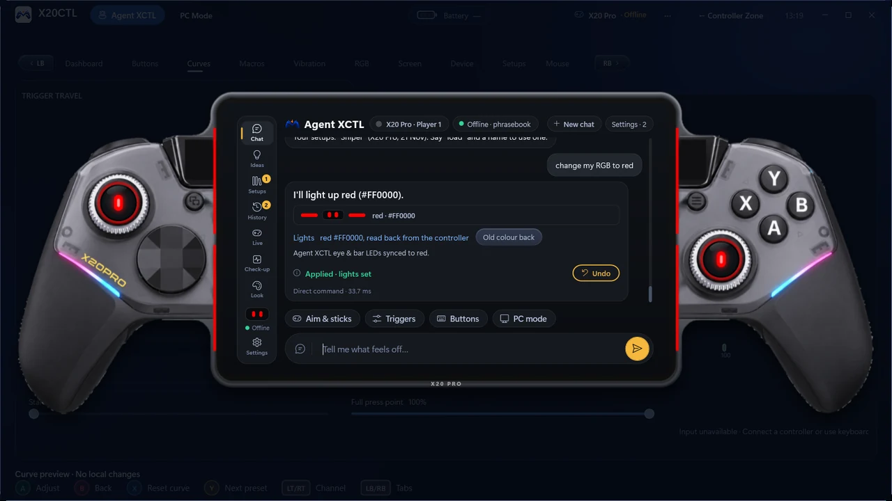
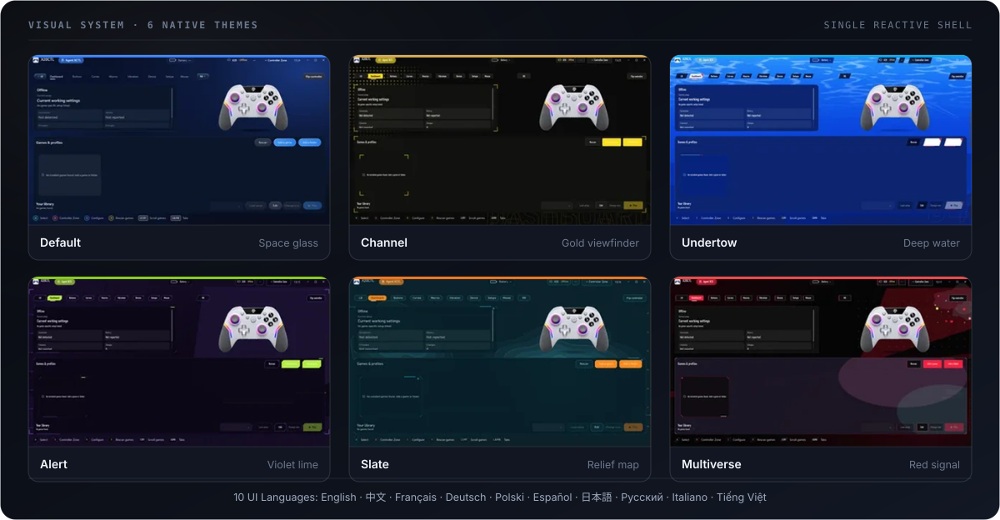
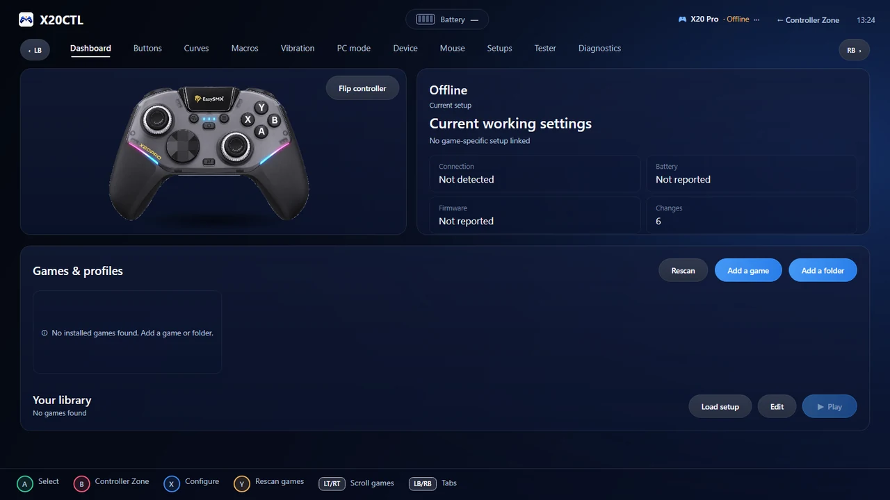
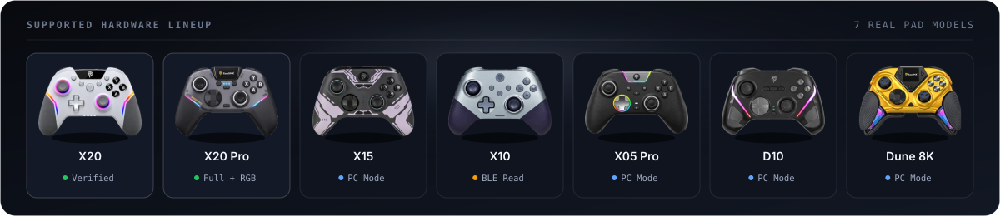
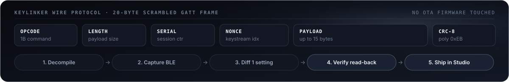

  <a href="#download"><b>Download V0.025</b></a> &nbsp;&middot;&nbsp;
  <a href="#highlights">Highlights</a> &nbsp;&middot;&nbsp;
  <a href="#supported-controllers">Controllers</a> &nbsp;&middot;&nbsp;
  <a href="#reverse-engineering">Protocol</a> &nbsp;&middot;&nbsp;
  <a href="CHANGELOG.md">Changelog</a> &nbsp;&middot;&nbsp;
  <a href="IF-YOUR-CONTROLLER-ISNT-WORKING.md">Troubleshooting</a>

> **Independent project.** X20CTL is open-source software. EasySMX supplied an X20 Pro to help develop it, but the app is not made, endorsed, sponsored or supported by EasySMX. Product names belong to their owners and are used only to say which controllers X20CTL works with.

## Highlights

### RGB Studio, Live Effects & 160x80 Screen (X20 Pro)

Configure all four LED zones live, run Rainbow Wave / Trigger Glow / Stick Heat / Ambient Screen Sync / Battery gauges, and upload static images or animated GIFs to the built-in `160x80` display over USB serial. Over the 2.4 GHz dongle (`413D:2131`), lighting and supported configuration automatically sync via simultaneous unpaired BLE whenever PC Bluetooth is on.

### 100% Offline Handheld Agent XCTL

Built-in assistant rendered inside your controller body with `3,048` handwritten phrases, Tab autocomplete, `+ New chat` cancellation, live Check-up drift audits, interactive RGB cards, help search, and multi-step Undo — zero cloud APIs or downloaded AI models.

### Stick & Trigger Curves, Buttons & Rear Paddle Macros

Shape stick and trigger curves (`Default`, `Quick`, `Slow`, `Smooth`, `Fine` presets or custom curves with inner/outer dead zones), listen-to-bind front & rear paddles (`M1–M4` / `M1–M6`), and assemble timed macro sequences cleanly.

### PC Mode — Xbox 360 / PS4, 64-Key Keyboard, Mouse & 4-Zone Vibration

Run software PC Mode across up to four players (`ViGEmBus` + `HidHide` on Windows, `evdev`/`uinput` on Linux) with per-game profiles, up to 64-key custom Keyboard chains, Controller as Mouse (`M1–M7`, `2–30 Hz` turbo, `View + Y`), and 4-motor Vibration up to `200%` boost (`View + Menu` pauses settings mid-game).

### 6 Native Themes & 10 Languages

<b>More Studio screens</b> — Live Lighting Effects, Buttons, Keyboard Sequences, 4-Zone Vibration, Diagnostics, Controller Check & Linux Studio

 

**Live Lighting Effects & Ambient Screen Sync**

**Buttons & Rear Paddle Visualizer**

**Keyboard Mapping & 64-Key Custom Sequences**

**4-Zone Grip/Trigger Vibration & 200% Boost**

**Read-Only Stick, Chatter & Report-Rate Diagnostics**

**Controller Check (Read & Write Identity Scan)**

**Linux Studio (Avalonia)**

## Supported Controllers

| Controller | On-device configuration | PC Mode | Status & Notes |
|---|---|---|---|
| **EasySMX X20** | Buttons, curves, macros (`M1–M4`), vibration | Yes | Verified BLE GATT + read-back check |
| **EasySMX X20 Pro** | Buttons, curves, macros (`M1–M6`), 4-motor vibration, RGB Studio, `160x80` screen | Yes | Verified; simultaneous `413D:2131` dongle + unpaired BLE when PC Bluetooth is on |
| **EasySMX X15** | Read-only preview | Yes | Full Windows/Linux PC Mode support |
| **EasySMX X10** | Experimental read-only BLE (`KRLY`) | Yes | Ported from EasyGamepad; awaiting physical X10 hardware check |
| **EasySMX X05 Pro** | Read-only preview | Yes | Includes DInput recognition hint in Write scan |
| **EasySMX D10** | Read-only preview | Yes | Full PC Mode remapping, curves, keyboard & mouse |
| **EasySMX Dune 8K** | 4-motor haptic visualizer & `M1–M4` layout | Yes | PC Mode remapping & trigger rumble; native protocol unverified |

> **DInput tip (`STK-7024X` / `0079:181C`):** If Windows or Steam detects your pad as `STK-7024X`, switch the physical controller back to XInput mode for full PC Mode support and reliable X20 Pro identification.

## Download

Official builds from [**Release V0.025**](https://github.com/AmjadAAYD/x20ctl/releases/tag/v0.025) &middot; Verify checksums against [`SHA256SUMS.txt`](https://github.com/AmjadAAYD/x20ctl/releases/download/v0.025/SHA256SUMS.txt):

| Platform | Package | Artifact | Notes |
|---|---|---|---|
| **Windows 10/11 (x64)** | Installer *(recommended)* | [`X20CTL-V0.025-windows-x64-setup.exe`](https://github.com/AmjadAAYD/x20ctl/releases/download/v0.025/X20CTL-V0.025-windows-x64-setup.exe) | Self-contained (.NET & assets bundled); Start menu + uninstaller |
| **Windows 10/11 (x64)** | Portable single exe | [`X20CTL-V0.025-windows-x64.exe`](https://github.com/AmjadAAYD/x20ctl/releases/download/v0.025/X20CTL-V0.025-windows-x64.exe) | Run anywhere without installing |
| **Linux (x86_64)** | AppImage | [`X20CTL-V0.025-linux-x86_64.AppImage`](https://github.com/AmjadAAYD/x20ctl/releases/download/v0.025/X20CTL-V0.025-linux-x86_64.AppImage) | Universal portable desktop bundle |
| **Linux (x86_64)** | Flatpak bundle | [`X20CTL-V0.025-linux-x86_64.flatpak`](https://github.com/AmjadAAYD/x20ctl/releases/download/v0.025/X20CTL-V0.025-linux-x86_64.flatpak) | Sandboxed desktop install ([guide](docs/linux-user-guide.md)) |
| **Linux (x86_64)** | glibc tarball | [`X20CTL-V0.025-linux-x64.tar.gz`](https://github.com/AmjadAAYD/x20ctl/releases/download/v0.025/X20CTL-V0.025-linux-x64.tar.gz) | Ubuntu, Fedora, Arch, Debian, openSUSE |
| **Linux (x86_64)** | musl tarball | [`X20CTL-V0.025-linux-musl-x64.tar.gz`](https://github.com/AmjadAAYD/x20ctl/releases/download/v0.025/X20CTL-V0.025-linux-musl-x64.tar.gz) | Alpine & musl-based systems |
| **Linux (CLI)** | Controller Check ZIP | [`X20CTL-V0.025-linux-check.zip`](https://github.com/AmjadAAYD/x20ctl/releases/download/v0.025/X20CTL-V0.025-linux-check.zip) | Standalone Python 3 `x20ctl-check` & `x20ctl-pcmode` (`uv run x20 scan`) |

- **Code signing:** Releases build on GitHub Actions straight from this repo, and X20CTL has applied for free open-source signing via the [SignPath Foundation](https://signpath.org/). Until active, Windows SmartScreen may warn — verify against `SHA256SUMS.txt` and never disable antivirus software.
- **Linux status:** Avalonia Linux Studio bundles compile on CI and pass headless verification, awaiting end-to-end physical Linux hardware runtime checks.
- [Linux User Guide](docs/linux-user-guide.md) &middot; [Version Numbering](docs/versions.md) &middot; [All Releases](https://github.com/AmjadAAYD/x20ctl/releases)

## Reverse Engineering

- **Transport:** Bluetooth LE GATT (+ USB serial for X20 Pro `160x80` screen uploads). OTA firmware characteristics are documented solely so they are never touched — **X20CTL never flashes firmware.**
- **Honest read-back verification:** Hardware memory is only written after identity and read-back have been verified; unsupported models stay local-only in drafts or software PC Mode.
- **Docs & scan tooling:** [Protocol Reference](docs/01-protocol.md) &middot; [Reverse-Engineering Log](docs/00-findings.md) &middot; [Controller Scan Kit](docs/controller-scan-kit/) &middot; [Research Policy](docs/research-policy.md)

## Local First

- **No account & zero telemetry:** Handheld Agent XCTL, setups, drafts, and PC Mode profiles stay in your local user folder.
- **Stable-only updates & opt-in uploads:** Update checks look at stable GitHub releases only (never pre-releases, toggleable off in **Tools**), game shelves read local launcher manifests only, PC Mode asks before installing pinned `ViGEmBus` (`1.22.0`) and `HidHide` (`1.5.230`) drivers, and network uploads occur only when you explicitly confirm **Scan and send** or **Send to X20CTL** feedback ([PRIVACY.md](PRIVACY.md)).

## Credits

- **Kiin & Team EasySMX** — for supplying an EasySMX X20 Pro to build, verify, and test X20CTL against real hardware.
- **[Edgard (`edgardmessias`)](https://github.com/edgardmessias)** — for decoding the X10 Bluetooth protocol in [EasyGamepad](https://github.com/edgardmessias/easygamepad).
- **[Monratis](https://github.com/Monratis)** — for resolving simultaneous mouse/gamepad focus and testing X20 Pro hardware support.
- Console layout inspired by [ApexSenseBridge (`Kayn arts`)](https://github.com/ReynArts/ApexSenseBridge); mouse defaults inspired by [Gopher360](https://github.com/Tylemagne/Gopher360). Support development on [Ko-fi](https://ko-fi.com/x20ctl).

## License

From V0.012 (4.1.0 Preview 3) onward, X20CTL is free software licensed under **[GNU General Public License v3.0 or later](LICENSE)**. Earlier MIT releases retain their headers in [`licenses/`](licenses/). See [NOTICE](NOTICE) and [THIRD_PARTY.md](THIRD_PARTY.md).

---
Everything on this page is also maintained in plain, selectable Markdown in [README.plain.md](README.plain.md) (used by offline Agent XCTL help search).
