<p align="center">
  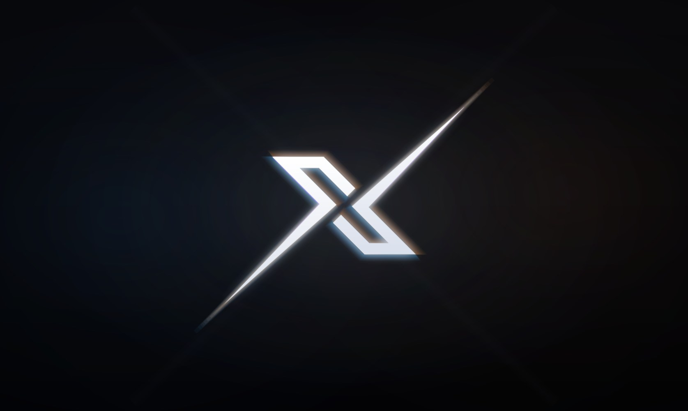
</p>

<h1 align="center">X20CTL</h1>

<p align="center"><b>A console-style controller studio for EasySMX pads, on your own PC.</b><br>
Remap buttons, shape sticks and triggers, build back-paddle macros, set vibration, and check that a controller really works.</p>

<p align="center">
  <a href="https://github.com/AmjadAAYD/x20ctl/releases/tag/v4.1.0-preview.3-exe"><b>Download 4.1.0 Preview 3</b></a> ·
  <a href="CHANGELOG.md">Changelog</a> ·
  <a href="IF-YOUR-CONTROLLER-ISNT-WORKING.md">Controller not working?</a> ·
  <a href="https://github.com/AmjadAAYD/x20ctl/issues">Report an issue</a>
</p>

> **Not affiliated with EasySMX.** X20CTL is an independent, open-source project. It is not made, endorsed, sponsored or supported by EasySMX. Product names belong to their owners and are used only to say which controllers X20CTL works with.

---

## What's new

X20CTL is now a **native Windows app**, rebuilt from scratch in WPF on .NET 10. It no longer uses a web page inside a window, and it no longer needs WebView2. Up to four players each pick their own controller. Every model opens the same Studio, and every page can be driven with a gamepad, like a console's big-picture mode.

**4.1.0 Preview 3 is a pre-release.** The EasySMX X20 is the only verified controller. The other seven models open as read-only previews. Their layouts, sticks and triggers are drawn and animated, but nothing is written to them. See [Supported controllers](#supported-controllers).

## Controller Zone

Every launch opens with the X20CTL intro: the controller draws itself, turns into the X, and the X flies into the logo at the top left as the Controller Zone appears. Press **Esc** to skip it or **M** to mute it, or turn it off under Tools → Opening intro. Each of the four players has a card. The selected card grows into the hero spot on the left, and the other three wait on the right. Press **+** on an empty card to choose a controller.

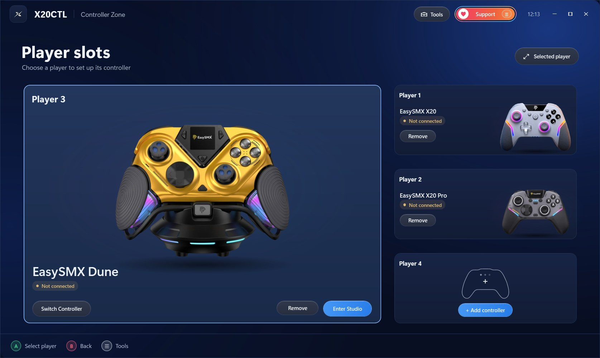

## Choose your controller

Pick the model you hold. Each card names what the pad has: stick and trigger type, lighting, screen and back buttons. Choosing a model sets the layout and tools; connecting the hardware is a separate step.

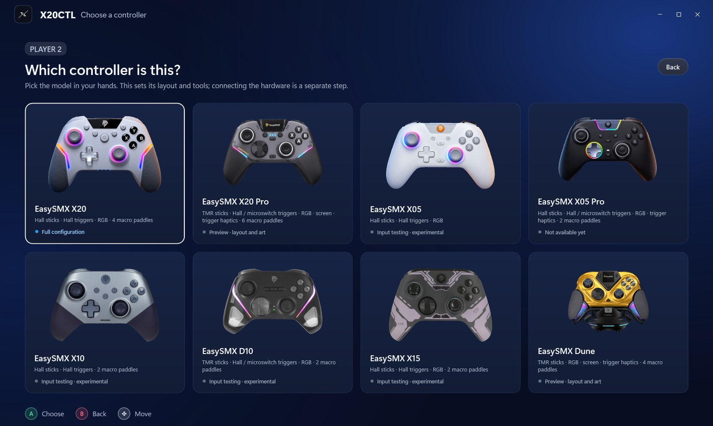

## Studio

### Dashboard

The Studio opens on the Dashboard. It shows the controller, its player slot, your draft changes and saved setups. It also finds the Steam and Epic games installed on this PC, so you can launch them from here. It only reads the launchers' own local files and never goes online.

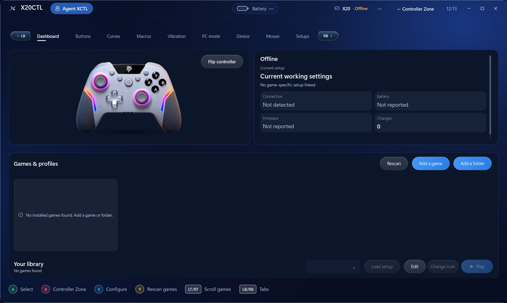

### Buttons

Pick a button on the controller, then press what it should do. Front and back views are included, plus an Outputs board of every remappable control. Use **Try it** to feel a change before you keep it.

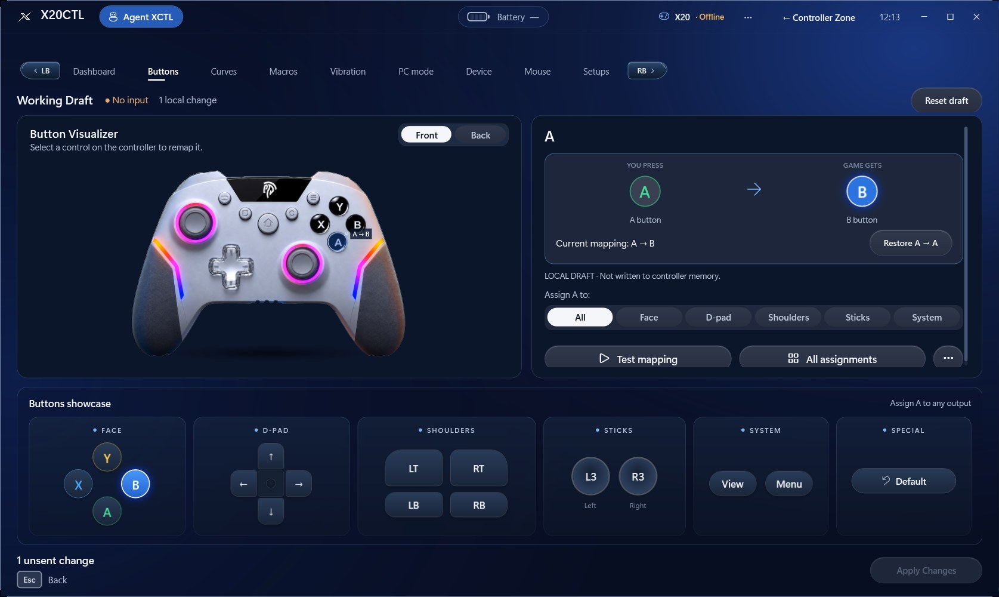

### Curves

Shape each stick and trigger separately: presets, inner deadzone and outer travel limit. The graph shows the input-to-output response you are building.

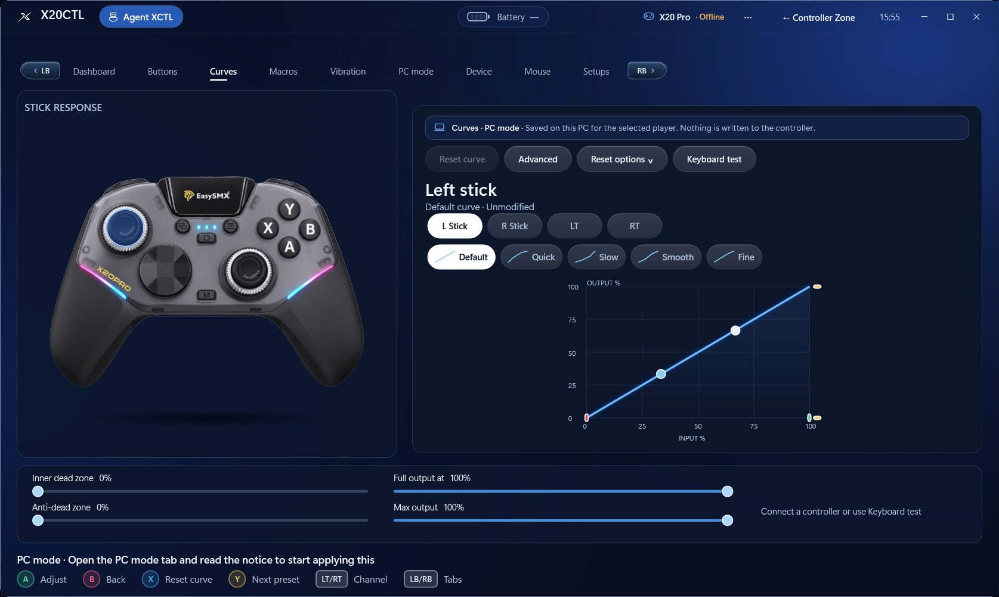

**Advanced** opens the fine stick tools, which PC mode applies on this PC for any controller:

- dead zones in 0.1% steps, anti-deadzone and max output;
- a square gate, up/down speed, or pure raw 1:1;
- presets, copy to the other stick, and a table of what the game gets at each push;
- **Measure drift**, which sets each inner dead zone just past how far the stick wanders on its own.

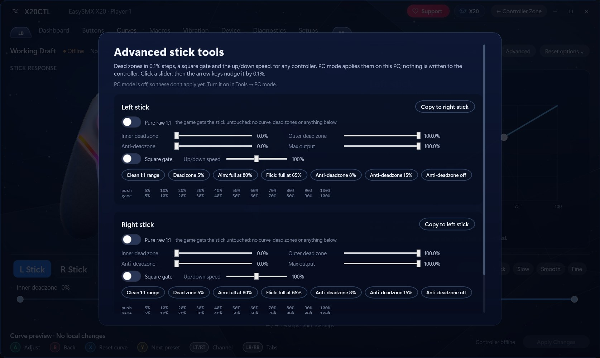

### Macros

Build sequences for the M back paddles, step by step, on a timeline. Each step holds buttons, stick directions or a pause, with its own timing. The M paddles are macro slots that send ordinary buttons. They never become extra buttons of their own.

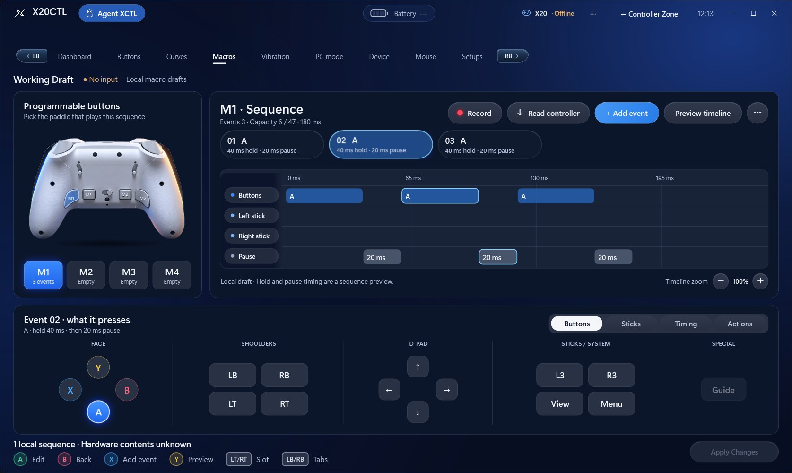

### Vibration

Set motor strength. The motors pulse on the picture like a heartbeat that speeds up as strength rises. This is a visual preview of your draft, not a reading from the motors. Only the X20 Pro and the Dune have trigger motors; every other model has two grip motors.

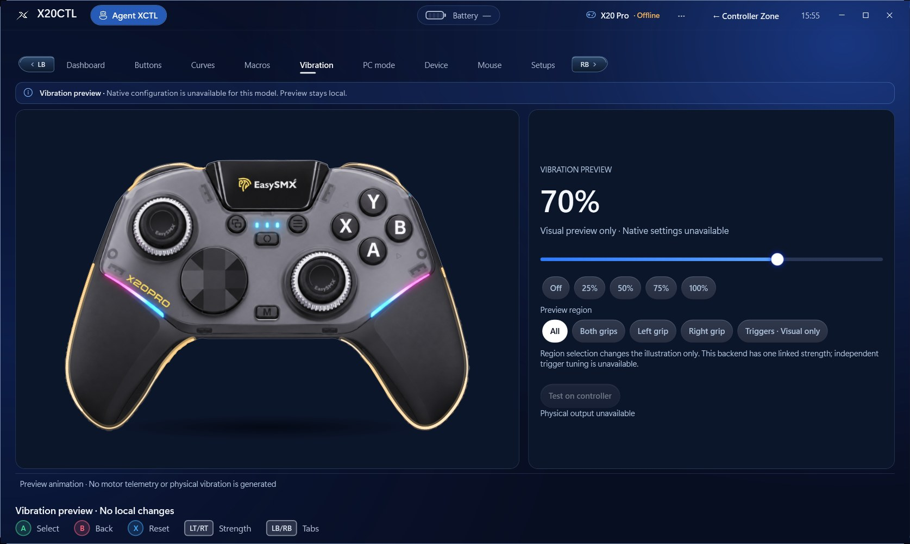

### Device

Shows the controller's battery, firmware, hardware revision and transport. Gameplay and configuration are listed as separate connections, along with what X20CTL supports on this model.

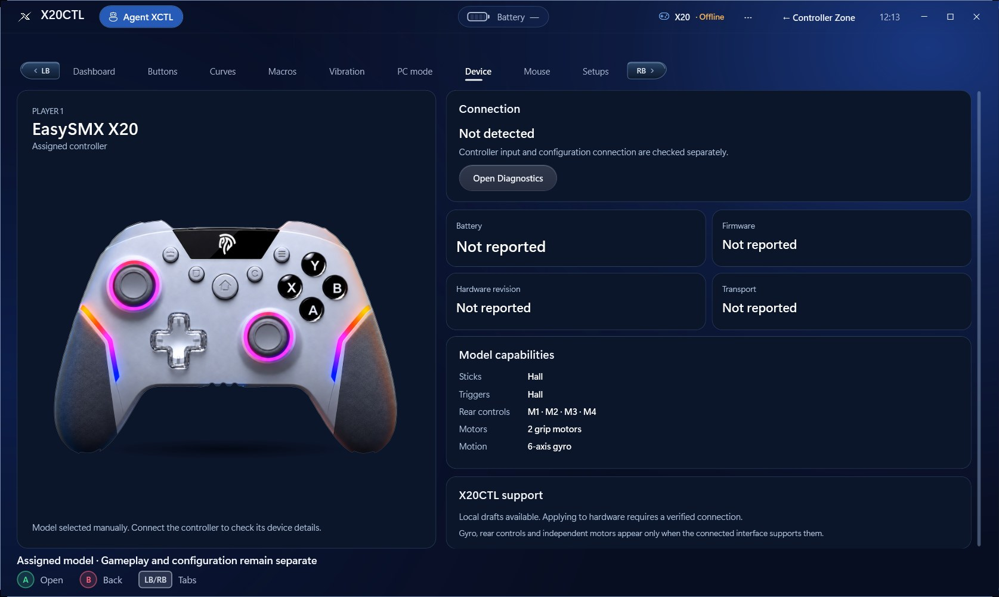

### Diagnostics

A live, read-only check of the controller:

- **Sticks:** a range trace with its roundness, where each stick rests (drift), and the smallest step it moves in.
- **Triggers:** how far each one travels.
- **Buttons:** every press, with chatter flagged, since a press too short for a finger usually means a worn switch.
- **Report rate:** how many reports a second the controller really sends.

**Copy report** puts the readings on the clipboard for a bug report. **Use as dead zone** puts a stick's measured drift straight into PC mode's dead zone. Hold B to leave.

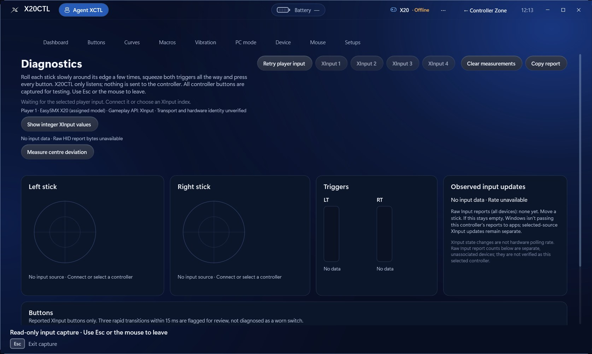

### Mouse

Use the controller as a mouse around Windows: from the couch, or in a game's launcher. One stick moves the pointer, the other scrolls, and every button does what you pick: left, right and middle click, back and forward, Enter, Escape, arrows, the Windows key, Task view, volume, the on-screen keyboard, or a slow pointer while held.

- Switch it on in the tab, from the tray icon, or by holding **View + Y** for a second on the controller.
- Speed, acceleration, dead zone, slow-pointer speed and scroll speed are all adjustable. Held arrows, Backspace and Space repeat like a keyboard.
- While it's on, X20CTL's own controller navigation pauses, and with PC mode on, games see a resting controller, so a click never also presses A in a game.
- Nothing is written to the controller. The idea comes from [Gopher360](https://github.com/Tylemagne/Gopher360); X20CTL's version is written fresh.

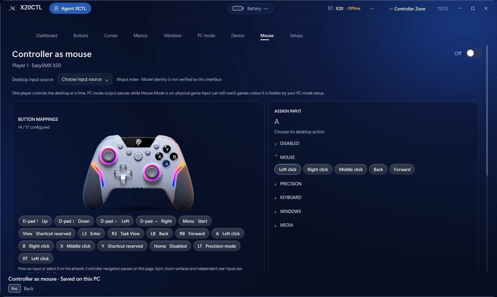

### Setups

Keep whole-controller setups in a local library: buttons, curves, macros and vibration together. Open, duplicate, rename, export and import them.

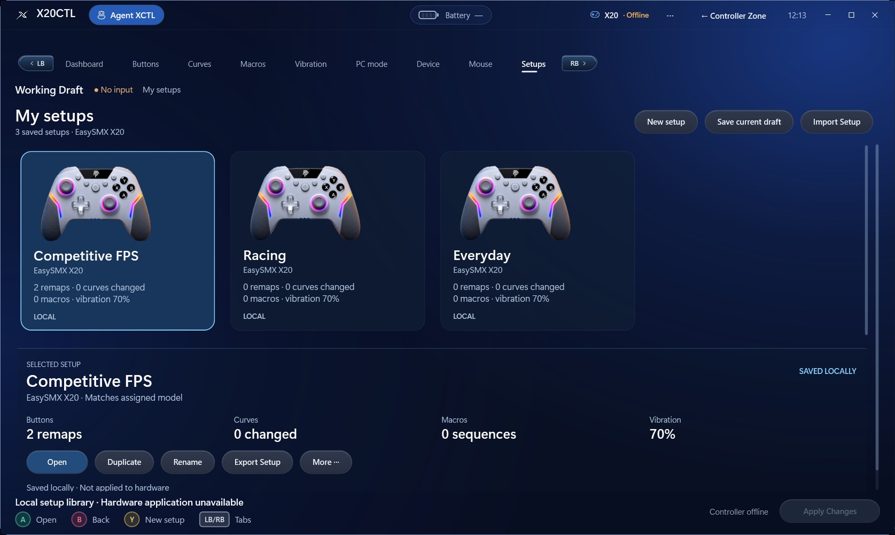

### Tester

See exactly what Windows receives from the controller: every button, both sticks and both triggers, live, with the front and back views.

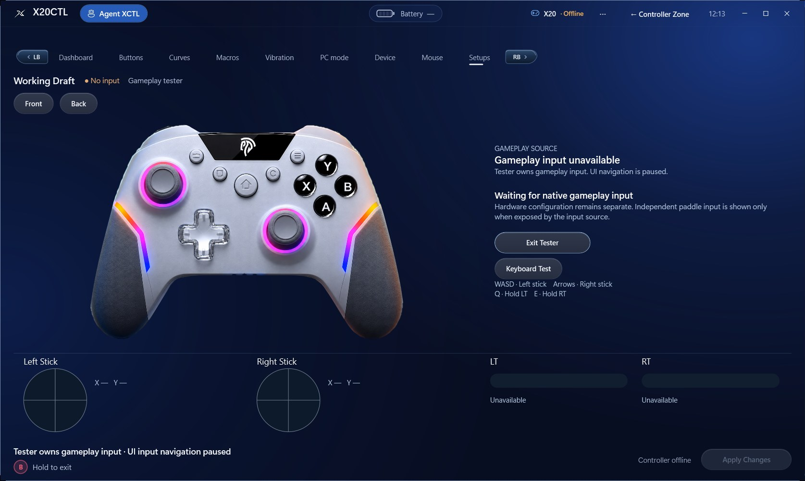

## Every controller gets the full Studio

Models that are not verified yet still open every page: Dashboard, Buttons, Curves, Macros, Vibration, Device, Setups and Tester. Each page wears a banner that states what is known about the controller and what isn't. Where sources disagree, the banner says so instead of guessing. Sticks and triggers move on every model.

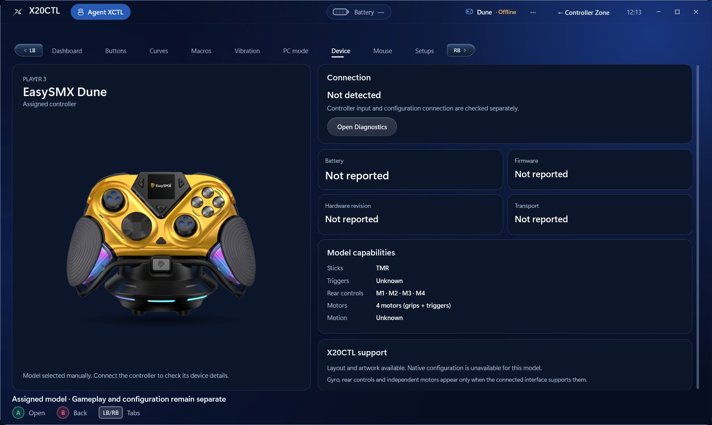

## Tools

Tools gathers help and extras: PC mode, the Controller Check, Replay Intro, About, Send feedback, Support X20CTL and the GitHub repository, plus switches for updates and for the opening intro (at launch, and its sound).

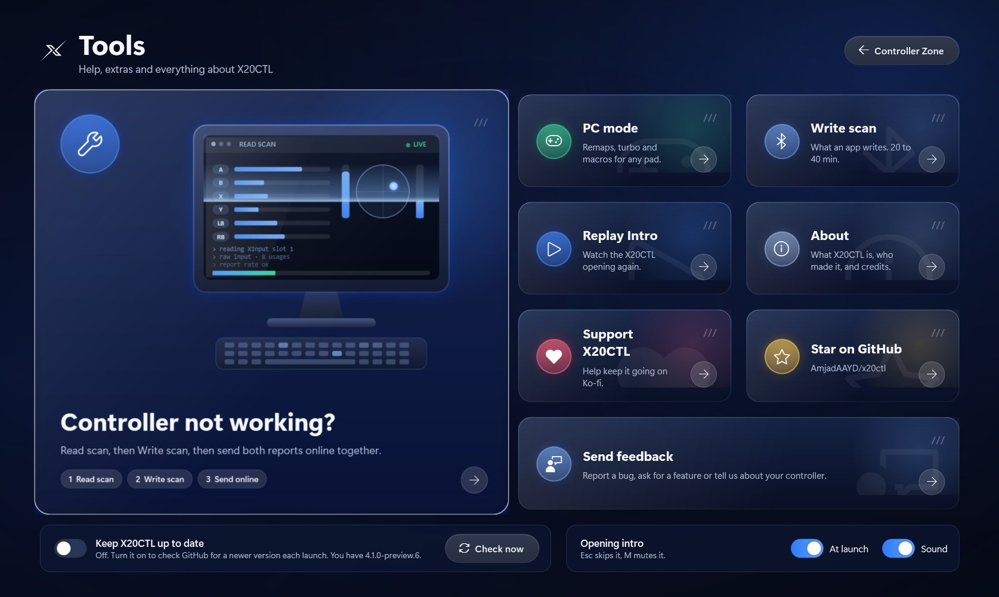

### PC mode

PC mode gives any controller remaps, turbo, stick and trigger curves and macros, including pads whose settings X20CTL can't write (the X05, X05 Pro and Dune). X20CTL reads the real controller, applies your settings, and hands the result to the game as a virtual Xbox controller while the real one is hidden. Nothing is written to the controller.

PC mode is a tab on every controller's Studio. While it's on, that controller's own **Buttons**, **Curves** (with Advanced) and **Macros** tabs edit the PC mode settings, for any model, and every change applies right away. The PC mode tab itself holds the switch, which settings you're editing (every game's, or a game's own), turbo, and sharing.

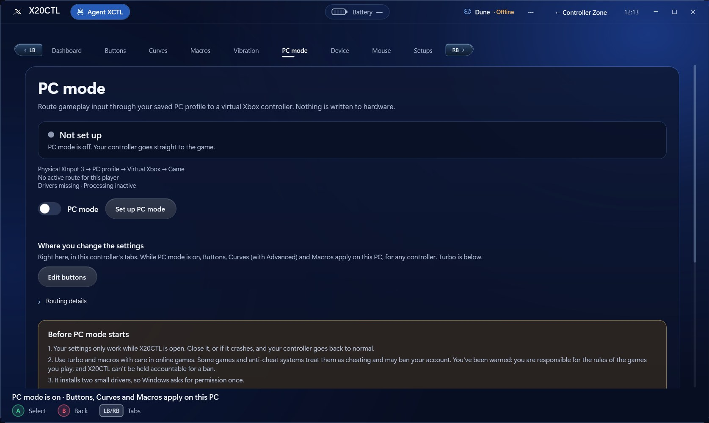

**Back paddles and macros.** PC mode can't see a back paddle. EasySMX paddles don't have a button of their own: each one sends an ordinary button (A, B, or whatever the controller was set to). So in PC mode, each macro slot is played by a real button you pick in the Macros tab, and that button plays the macro instead of its usual job. Pick one you don't use in that game.

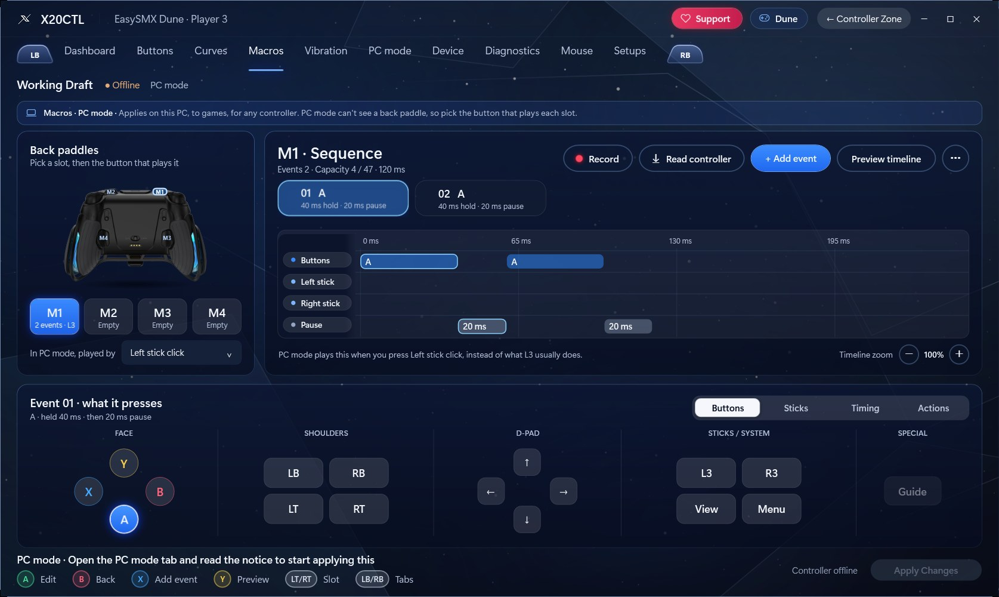

- It's on by default but does nothing until you change a setting.
- It only works while X20CTL is open. Close it and the controller goes back to normal.
- The first time, it installs two small drivers by Nefarius: [ViGEmBus](https://github.com/nefarius/ViGEmBus) (the virtual controller) and [HidHide](https://github.com/nefarius/HidHide) (hides the real one). Their official installers are inside the exe, checked against pinned hashes. Remove them any time from Windows Settings → Apps.
- **Up to four controllers at once, each with its own settings.** Each one gets its own virtual Xbox controller, in the same order. Player 1's settings go to the first controller Windows sees, Player 2's to the second, and so on; each controller's Studio edits its own.
- **Settings per game.** Under *Settings for*, give a running game its own settings (per controller); X20CTL switches to them while that game is in front, and back to *Every game* otherwise.
- **Hold View + Menu for a second** to switch your settings off mid-game (the controller then works as it normally does), and again to switch them back on.
- **Share settings** as a file or as a short code to paste in a chat. Only the settings go in, never anything about you or your PC. The Linux script reads and writes the same codes and files.
- Macros can be **recorded**: in the Macros tab, press Record and play the moves on the controller.
- The tray icon shows the controller's battery and warns once when it runs low.
- **Turbo and macros can get you banned in online games.** You are responsible for the rules of the games you play.

### Controller Check

Is the controller not working? The Controller Check walks you through every button, stick and trigger, one step at a time. It shows held times, the stick report rate and resolution, battery, button chatter (presses too short for a finger, a sign of a worn switch), and what the controller reports to Windows. It then saves a ZIP report to `Documents\X20CTLInputReports`.

It only reads. It never changes settings, lighting, vibration or firmware. Sending the report is your choice: before the scan starts, pick **Scan and send** or **Scan, keep it on this PC**.

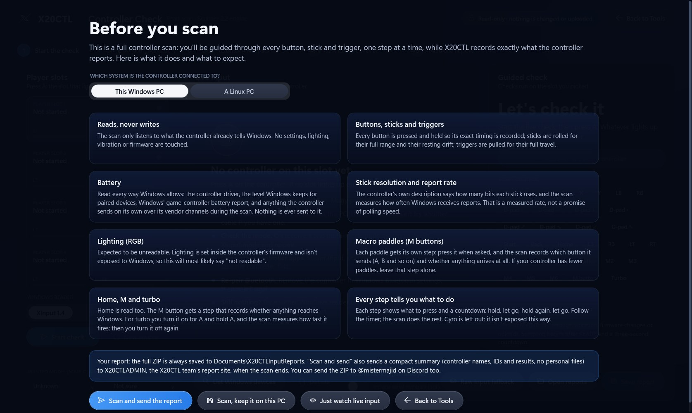

The Controller Check is the **Read scan**. Its partner, the **Write scan** (Tools), learns what KeyLinker writes to a controller. You change one setting in KeyLinker on an Android phone or an iPhone while the phone's Bluetooth log records, then open the log here, and you can send the findings to X20CTL. X20CTL shows who the controller says it is, what it offers, and the bytes the app changed. X20CTL sends nothing to the controller. It's slow: plan on 20 to 40 minutes the first time.

Without a phone log, the command line can compare the controller's own settings before and after a change:
`x20 state save before.json --label before`, change one setting in the official app and close it,
`x20 state save after.json --label after`, then `x20 state diff before.json after.json`. It shows which record
and bytes changed, not the messages that changed them.

### About

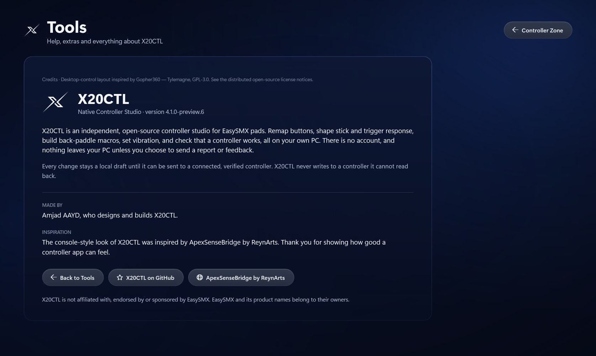

## Supported controllers

| Controller | Status in 4.1.0 Preview 3 |
|---|---|
| **EasySMX X20** | Verified. Full Studio: buttons, curves, macros (M1–M4), vibration, setups, tester |
| EasySMX X20 Pro | Read-only preview: TMR sticks, six back buttons, four motors including the triggers |
| EasySMX Dune | Read-only preview: TMR sticks, M1–M4, four motors including the triggers |
| EasySMX X15 | Read-only preview |
| EasySMX X10 | Read-only preview |
| EasySMX X05 | Read-only preview |
| EasySMX X05 Pro | Read-only preview |
| EasySMX D10 | Read-only preview |

For a preview model, nothing is written to the controller and nothing is stored as if it had been. A model becomes verified only once its settings can be read back from real hardware. Controller Check reports from owners help get each model there.

## Download

**Windows:** download **[X20CTL-4.1.0-preview.3-windows-x64.exe](https://github.com/AmjadAAYD/x20ctl/releases/download/v4.1.0-preview.3-exe/X20CTL-4.1.0-preview.3-windows-x64.exe)** and run it. That's it: one file, nothing to extract or install. The first launch unpacks the engine and data into your temp folder, so it takes a moment longer than later launches.

Would you rather have a folder? The [ZIP release](https://github.com/AmjadAAYD/x20ctl/releases/tag/v4.1.0-preview.3) has the same app unpacked: extract the whole `X20CTL` folder and run **X20Ctl.exe**.

You need Windows 10 or 11 (x64). Everything is bundled: you don't need to install .NET, Python, a browser runtime or an account.

**Code signing:** releases are built on GitHub Actions straight from this repository, and X20CTL has applied for free code signing for open-source projects from the [SignPath Foundation](https://signpath.org). Until that is approved, the exe is **unsigned**, so Windows SmartScreen may warn you. Check the download against the release's `SHA256SUMS.txt`. Never turn off your antivirus to run it.

**Linux:** [X20CTL-4.1.0-preview.3-linux-check.zip](https://github.com/AmjadAAYD/x20ctl/releases/download/v4.1.0-preview.3-exe/X20CTL-4.1.0-preview.3-linux-check.zip). The Studio is Windows-only for now; this ZIP contains the Controller Check as a standalone script (`x20ctl-check.py`, Python 3). A native Linux build of the full Studio is planned.

The last stable release is still [4.0.1](https://github.com/AmjadAAYD/x20ctl/releases/tag/v4.0.1).

## Local first

- No account. No telemetry. Update checks happen only if you turn on **Keep X20CTL up to date** in Tools. PC mode installs its two drivers only when you press **Set up PC mode**. Your setups, drafts and assignments stay in your user folder.
- Every change is a **local draft** until it can be sent to a connected, verified controller. X20CTL never writes to a controller it cannot read back.
- The game shelf reads only the Steam and Epic launchers' own local files.
- The only uploads are a Controller Check report when you choose **Scan and send**, and feedback when you press **Send to X20CTL**. The [privacy policy](PRIVACY.md) lists exactly what each one contains. External links, such as Support and GitHub, open in your browser and only when you click them.
- X20CTL does not flash firmware.

## Build from source

You need the .NET 10 SDK on Windows:

```powershell
git clone https://github.com/AmjadAAYD/x20ctl.git
cd x20ctl
dotnet build desktop-dotnet\X20Ctl.Product\X20Ctl.Product.csproj -c Release
```

The controller art is generated from the source pictures by `tools/build_native_controller_layers.py`, and the outlines by `tools/build_controller_outlines.py`. The protocol research and the earlier Python and React desktop lines are still in the repository: see [docs/](docs/) and the [protocol reference](docs/01-protocol.md).

## Credits

**Made by Amjad AAYD.**

The console-style look was inspired by [ApexSenseBridge by Kayn arts (ReynArts)](https://github.com/ReynArts/ApexSenseBridge). The credit is for design inspiration only; no code was taken from it. X20CTL has its own branding, artwork and implementation.

If X20CTL helps you, you can [support it on Ko-fi](https://ko-fi.com/x20ctl), or simply star the repo.

## License

From 4.1.0 Preview 3, X20CTL is free software under the **[GNU General Public License v3.0 or later](LICENSE)**. You may use, study, share and change it. If you distribute a modified version, it must stay open under the same licence.

Releases up to and including 4.1.0 Preview 2 were published under MIT, and code contributed under MIT keeps its notice ([licenses/](licenses/)). See [NOTICE](NOTICE) for details and the full non-affiliation statement.
