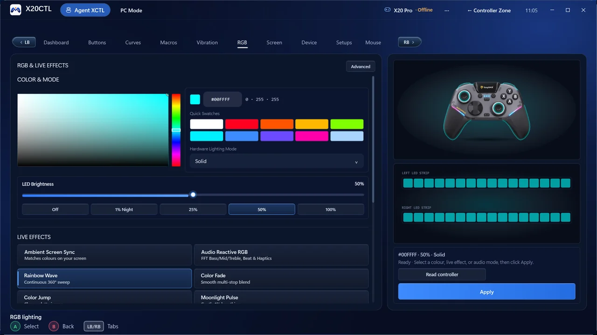
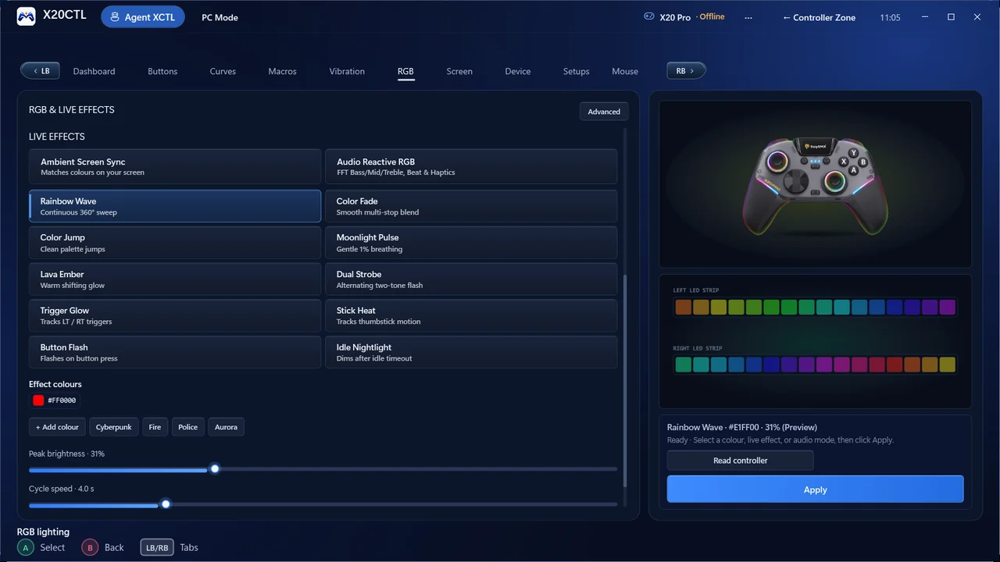
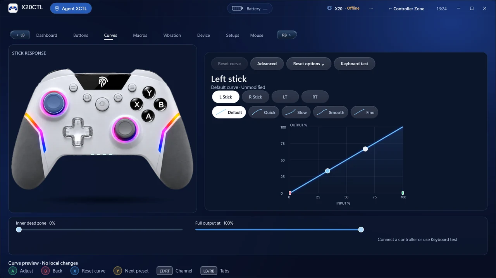
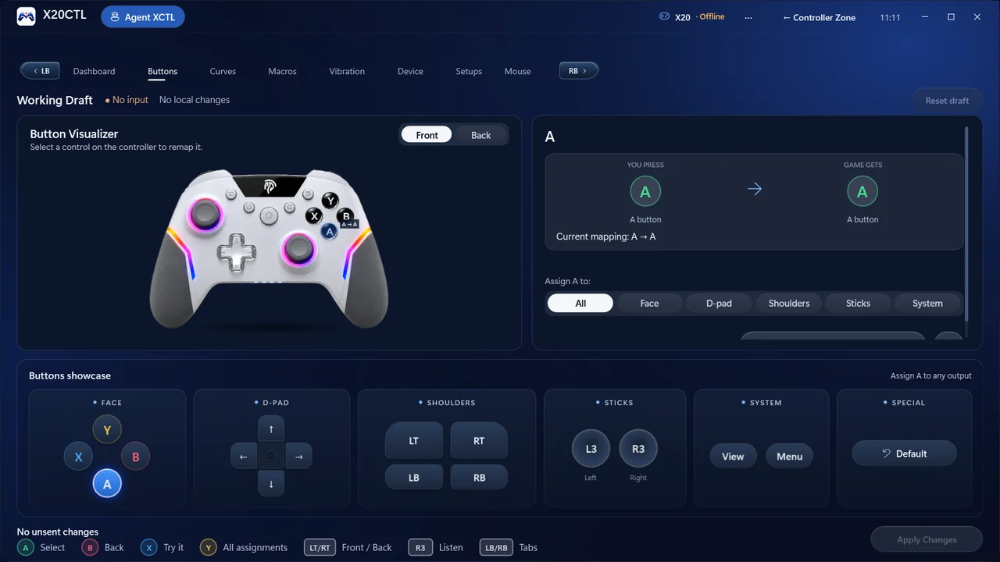
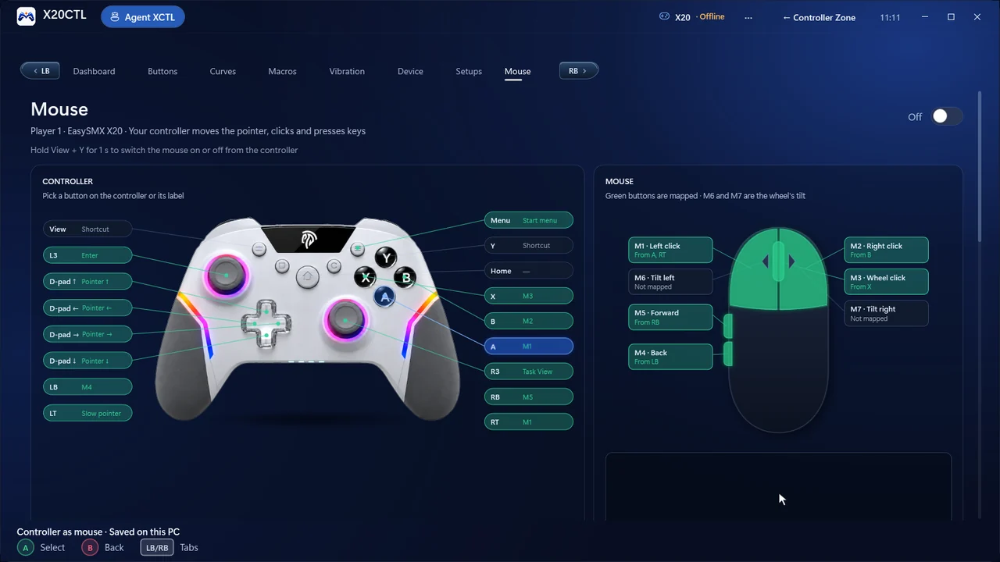
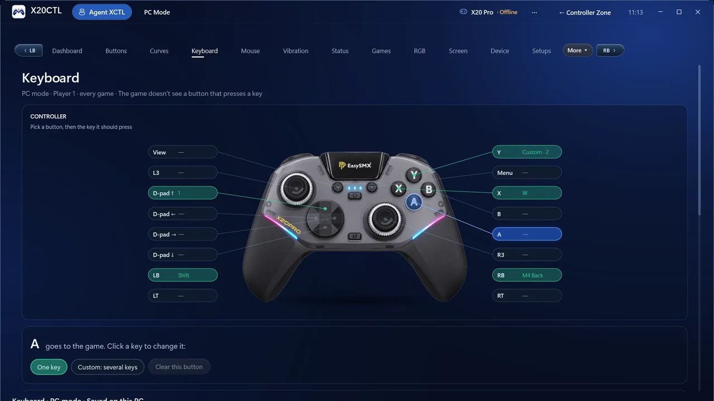
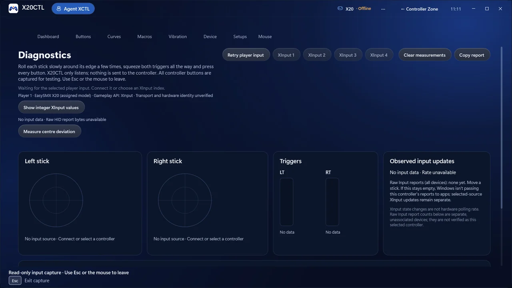
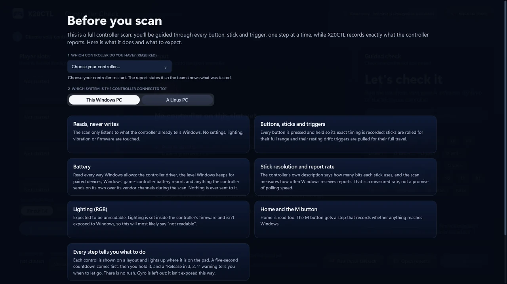

# X20CTL - Lightweight control studio for EasySMX controllers

Open-source Windows and Linux desktop alternative to the KeyLinker phone app. Configure buttons, paddles, stick/trigger curves, macros, 4-zone vibration, RGB lighting, and the X20 Pro `160x80` screen, or run low-latency PC Mode for up to 4 players across **EasySMX X20 Pro, X20, X15, X10, X05 Pro, D10, and Dune 8K**.

  
  
  
  
  
  

  

   &nbsp;
   &nbsp;
  

<strong>Like X20CTL? Star the repo to help other EasySMX owners find it.</strong>

- [FAQ & Quick Answers](docs/FAQ.md)
- [Troubleshooting (Controller not working?)](IF-YOUR-CONTROLLER-ISNT-WORKING.md)
- [Linux User Guide](docs/linux-user-guide.md)
- [Protocol Reference & Reverse Engineering](docs/01-protocol.md)
- [Changelog](CHANGELOG.md)
- [Follow Updates on X (@AmjadCTL)](https://x.com/AmjadCTL)

  

> [!NOTE]
> **Independent open-source project.** EasySMX supplied an X20 Pro to build and test X20CTL, but the app is not made, endorsed, sponsored, or supported by EasySMX.
> Shopping for an EasySMX pad? Using [`easysmx.com/?ref=X20CTL`](https://www.easysmx.com/?ref=X20CTL) supports X20CTL (10% affiliate commission at no extra cost to you), or you can [support directly on Ko-fi](https://ko-fi.com/x20ctl).

---

## Advantages

1. **No KeyLinker phone app needed:** Configure your X20 or X20 Pro directly on Windows or Linux over Bluetooth LE or simultaneous `2.4 GHz` dongle + unpaired BLE.
2. **Zero bloat, zero telemetry:** Shipped as a portable single `.exe` or standard installer (Windows) and AppImage/Flatpak/tarball (Linux) with no cloud accounts or background adware.
3. **Unlocks desktop-only features:** Live **Ambient Screen Sync** (LEDs match your monitor), custom images/GIFs on the X20 Pro `160x80` LCD, **100% offline Agent XCTL**, and per-game **PC Mode** profiles.
4. **Verified-safe hardware writes:** Never flashes controller firmware. Every native change backs up a local checkpoint, writes once, and verifies read-back against physical controller memory.
5. **Up to 4 players with PC Mode:** Software bridge via signed [ViGEmBus](https://github.com/nefarius/ViGEmBus) + [HidHide](https://github.com/nefarius/HidHide) on Windows or `/dev/uinput` on Linux outputs clean virtual **Xbox 360** or **DualShock 4** pads for every listed EasySMX model.

---

## Features

### RGB Studio, Live Effects & `160x80` Screen (X20 Pro)
Configure 4-zone LED colours (`Left`, `Right`, `Middle`, `Logo`), palette swatches, brightness presets, Rainbow Wave, Trigger Glow, Stick Heat, **Ambient Screen Sync**, and Battery gauges. Over the `2.4 GHz` dongle (`413D:2131`), lighting and settings sync automatically over simultaneous unpaired BLE whenever PC Bluetooth is enabled. Upload images or animated GIFs to the built-in `160x80` LCD over USB serial.

| RGB Studio | Live Lighting Engine |
|---|---|
|  |  |

### 100% Offline Handheld Agent XCTL
Ask in plain language inside your chosen controller frame in the title bar: 3,048 handwritten phrases, **Tab** autocomplete, `+ New chat` cancellation, live **Check-up** drift audits, interactive RGB cards, offline doc search, and multi-step **Undo** with zero external AI calls.

  

### Stick & Trigger Curves, Buttons & Rear Paddle Macros
Listen-to-bind front buttons and rear paddles (`M1-M4` / `M1-M6`), sculpt stick and trigger response curves (`Default`, `Quick`, `Slow`, `Smooth`, `Fine`, or custom points) with inner/outer dead zones, and build timed sequence macro timelines with instant local draft previews.

| Stick & Trigger Curves | Buttons & Rear Paddles |
|---|---|
|  |  |

### PC Mode: Xbox 360 / PS4, 64-Key Sequences, Mouse & 4-Zone Vibration
Per-game software profiles let you bind `M1-M7` to up to 64 keyboard keys or mouse actions, drive the desktop cursor with **Controller as Mouse** (toggle anytime with `View + Y`), boost game rumble up to `200%` across 4 motors, and pause/resume mid-game with `View + Menu`.

| Controller as Mouse | 4-Zone Vibration & 200% Boost |
|---|---|
|  |  |

More Studio screens: Keyboard 64-Key Sequences, Diagnostics, Controller Check & Linux Studio

| Keyboard Sequences | Stick Diagnostics |
|---|---|
|  |  |

| Controller Check | Linux Studio (Avalonia) |
|---|---|
|  |  |

---

## Supported Controllers

  

| Controller | On-Device Configuration | PC Mode | Status |
|---|---|---|---|
| **EasySMX X20** | Buttons, curves, macros (`M1-M4`), vibration | Yes | Verified BLE GATT |
| **EasySMX X20 Pro** | Full BLE + 4-motor vibration, RGB Studio, `160x80` USB screen | Yes | Verified BLE + USB (`2.4G` + unpaired BLE) |
| **EasySMX X15** | Read-only preview | Yes | PC Mode supported |
| **EasySMX X10** | Experimental KRLY BLE read (ported from EasyGamepad) | Yes | Awaiting physical X10 hardware check |
| **EasySMX X05 Pro** | Read-only preview + DInput recognition helper | Yes | PC Mode supported |
| **EasySMX D10** | Read-only preview | Yes | PC Mode supported |
| **EasySMX Dune 8K** | 4-motor haptic visual + `M1-M4` layout | Yes | PC Mode supported |

> [!TIP]
> **DInput `STK-7024X` (`0079:181C`):** If Windows or Steam labels your EasySMX pad as `STK-7024X`, switch the controller back to XInput mode for full PC Mode and X20 Pro detection.
> **Thinking of buying an EasySMX pad?** [Shop EasySMX with referral link (`?ref=X20CTL`)](https://www.easysmx.com/?ref=X20CTL) to support development at no extra cost.

---

## Download (V0.025)

All official builds are compiled in GitHub Actions and published under [**Release V0.025**](https://github.com/AmjadAAYD/x20ctl/releases/tag/v0.025). Verify any file against [`SHA256SUMS.txt`](https://github.com/AmjadAAYD/x20ctl/releases/download/v0.025/SHA256SUMS.txt).

| Platform | Download | Notes |
|---|---|---|
| **Windows 10/11 (x64) Installer** | [`X20CTL-V0.025-windows-x64-setup.exe`](https://github.com/AmjadAAYD/x20ctl/releases/download/v0.025/X20CTL-V0.025-windows-x64-setup.exe) | Recommended; bundled runtime, Start menu + uninstaller |
| **Windows 10/11 (x64) Portable** | [`X20CTL-V0.025-windows-x64.exe`](https://github.com/AmjadAAYD/x20ctl/releases/download/v0.025/X20CTL-V0.025-windows-x64.exe) | Single portable executable |
| **Linux (x86_64) AppImage** | [`X20CTL-V0.025-linux-x86_64.AppImage`](https://github.com/AmjadAAYD/x20ctl/releases/download/v0.025/X20CTL-V0.025-linux-x86_64.AppImage) | Universal Linux bundle ([Linux guide](docs/linux-user-guide.md)) |
| **Linux (x86_64) Flatpak** | [`X20CTL-V0.025-linux-x86_64.flatpak`](https://github.com/AmjadAAYD/x20ctl/releases/download/v0.025/X20CTL-V0.025-linux-x86_64.flatpak) | Sandboxed Flatpak bundle |
| **Linux (x64) glibc tarball** | [`X20CTL-V0.025-linux-x64.tar.gz`](https://github.com/AmjadAAYD/x20ctl/releases/download/v0.025/X20CTL-V0.025-linux-x64.tar.gz) | Standard glibc archive |
| **Linux (x64) musl tarball** | [`X20CTL-V0.025-linux-musl-x64.tar.gz`](https://github.com/AmjadAAYD/x20ctl/releases/download/v0.025/X20CTL-V0.025-linux-musl-x64.tar.gz) | musl distributions (Alpine, Void) |
| **Linux Controller Check ZIP** | [`X20CTL-V0.025-linux-check.zip`](https://github.com/AmjadAAYD/x20ctl/releases/download/v0.025/X20CTL-V0.025-linux-check.zip) | Standalone Python diagnostic scripts |

> [!IMPORTANT]
> **Code signing:** X20CTL has applied for free open-source code signing through the [SignPath Foundation](https://signpath.org/). Until active, Windows binaries are **unsigned**, so SmartScreen may prompt on first run. Always verify downloads with [`SHA256SUMS.txt`](https://github.com/AmjadAAYD/x20ctl/releases/download/v0.025/SHA256SUMS.txt) and never disable your antivirus. See [docs/versions.md](docs/versions.md) for versioning rules.

---

## Reverse Engineering & Safety

X20CTL decodes EasySMX's undocumented KeyLinker BLE GATT protocol (`opcode`, `length`, `serial`, `nonce`, `payload`, reflected `CRC-8` polynomial `0xEB` initial `0x00`) plus the USB serial protocol for the X20 Pro `160x80` display.

- **Verified writes only:** Nothing is written to controller flash without read-back confirmation; unverified models stay in software PC Mode.
- **No firmware flashing:** X20CTL leaves controller OTA/firmware services completely untouched.
- **Learn more:** [Protocol Reference](docs/01-protocol.md) · [Reverse-Engineering Log](docs/00-findings.md) · [Controller Scan Kit](docs/controller-scan-kit/) · [Research Policy](docs/research-policy.md)

## Local First & Privacy

- No accounts, no tracking, and no telemetry. Handheld Agent XCTL, drafts, game manifest scans, and PC Mode run 100% locally.
- Diagnostic uploads only happen when you explicitly click **Scan and send** or **Send to X20CTL** feedback. See [PRIVACY.md](PRIVACY.md) and [SECURITY.md](SECURITY.md).

## Credits & Support

- **Special thanks to Kiin from Team EasySMX** for supplying an EasySMX X20 Pro controller to build and test X20CTL.
- **Thanks to [Edgard (edgardmessias)](https://github.com/edgardmessias)** for decoding the X10 Bluetooth protocol in [EasyGamepad](https://github.com/edgardmessias/easygamepad).
- **Thanks to [Monratis](https://github.com/Monratis)** for resolving simultaneous mouse/gamepad focus and testing X20 Pro hardware support.
- Console layout inspired by [ApexSenseBridge (Kayn arts)](https://github.com/ReynArts/ApexSenseBridge); mouse defaults inspired by [Gopher360](https://github.com/Tylemagne/Gopher360).
- Support development on **[Ko-fi](https://ko-fi.com/x20ctl)**, via **[EasySMX referral (`?ref=X20CTL`)](https://www.easysmx.com/?ref=X20CTL)**, or follow updates on **[@AmjadCTL](https://x.com/AmjadCTL)**.

## License

From V0.012 (4.1.0 Preview 3), X20CTL is licensed under **[GNU General Public License v3.0 or later](LICENSE)**. Earlier MIT releases retain their notices in [`licenses/`](licenses/). See [NOTICE](NOTICE) and [THIRD_PARTY.md](THIRD_PARTY.md).

Everything above is also mirrored in searchable plain text in <a href="README.plain.md">README.plain.md</a>.

