# X20CTL

**A controller studio for EasySMX pads.** Remap, shape curves, build macros, diagnose, and use PC mode, on your own PC.

[Download V0.017](https://github.com/AmjadAAYD/x20ctl/releases/tag/v0.017) · [Changelog](CHANGELOG.md) · [Controller not working?](IF-YOUR-CONTROLLER-ISNT-WORKING.md) · [Issues](https://github.com/AmjadAAYD/x20ctl/issues)

**Thank you EasySMX for supplying an EasySMX X20 Pro to build and test X20CTL.**

*This is the plain-text version of the README. The main README is an illustrated page; this copy keeps everything selectable and copyable.*

> **Independent project.** X20CTL is open-source software. EasySMX supplied an X20 Pro to help develop it, but the app is not made, endorsed, sponsored or supported by EasySMX. Product names belong to their owners and are used only to say which controllers X20CTL works with.

## What it is

X20CTL is a native Windows app for EasySMX controllers. It gives every pad a console-style studio: remap buttons, shape the sticks and triggers, build macros for the back paddles, preview vibration, check that a controller really works, and use it as a mouse. It runs entirely on your PC, with no account and no web page inside a window. Up to four players each pick their own controller, and every page can be driven with a gamepad, like a console's big-picture mode.

Everything below is shown on the EasySMX X20 Pro.

## Reverse engineering

EasySMX configures its pads from a phone app (KeyLinker), and the protocol it speaks was never documented. X20CTL exists because that protocol had to be recovered, checked against real hardware, and rebuilt as a desktop app that runs on your own PC.

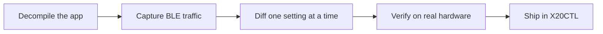

Every message to the controller is one small packet, written to a single GATT characteristic and then scrambled with two fixed keystreams. That is obfuscation, not cryptography.

| Field | Meaning |
|---|---|
| opcode | what the packet asks for |
| length | bytes that follow |
| serial | counts packets in a session |
| nonce | picks the keystream position |
| payload | up to 15 bytes |
| CRC-8 | reflected polynomial `0xEB`, initial value `0x00` |

Details and the evidence behind them: [protocol reference](docs/01-protocol.md).

- **Transport:** Bluetooth LE GATT. A configuration service with one write and one notify characteristic. The OTA firmware service is documented so it can be left alone: X20CTL does not flash firmware.
- **Fingerprinting:** the controllers' Bluetooth address prefixes tell models apart far better than the cloned `045E:028E` USB ID.
- **Honest status:** a model is marked *verified* only after its settings can be read back from real hardware. Everything else is a read-only preview, and nothing is written to a controller X20CTL cannot read back.
- **Read scan and Write scan:** the in-app [Controller Check](#controller-check) and the phone-log-based Write scan let owners contribute evidence for new models.
- **Research policy:** raw captures and personal data stay private. Only reviewed, derived implementation goes in this repository: [docs/research-policy.md](docs/research-policy.md).

**Read more:** [protocol reference](docs/01-protocol.md) · [reverse-engineering log](docs/00-findings.md) · [controller scan kit](docs/controller-scan-kit/)

## Studio tour

### Controller Zone

The home screen. Each of the four players has a card; the selected card grows into the hero spot on the left and the other three wait on the right. Press **+** on an empty card to choose a controller. The app opens with a short intro (**Esc** skips it, **M** mutes it, and Tools → Opening intro turns it off).

<p align="center">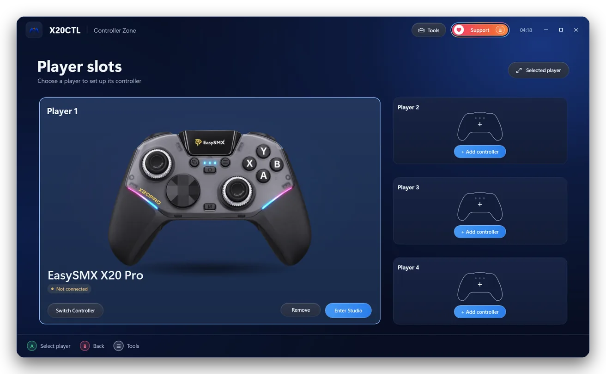</p>

### Choose your controller

Pick the model you hold. Each card names what the pad has: stick and trigger type, lighting, screen and back buttons. Choosing a model sets the layout and tools; connecting the hardware is a separate step.

<p align="center">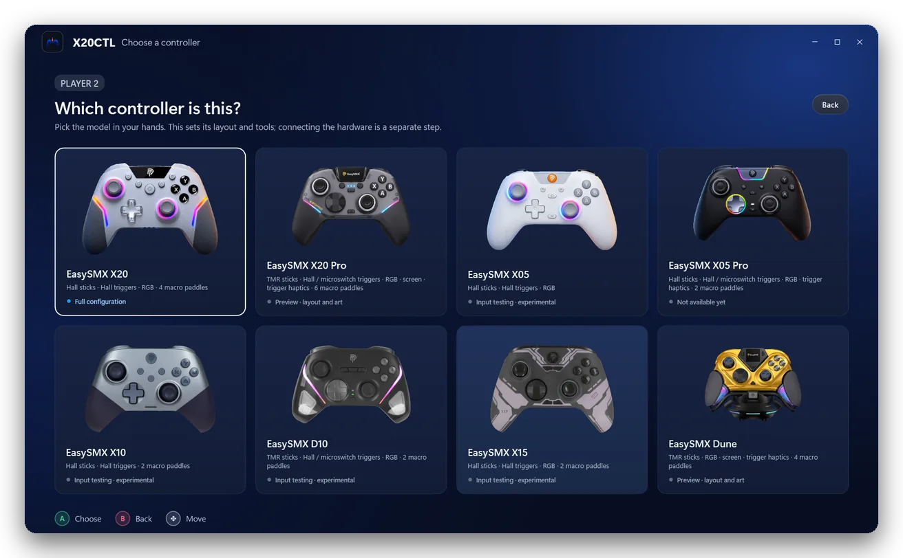</p>

### Agent XCTL

A small assistant drawn as a controller, in the Studio's title bar. Tell it in your own words how you play and it sets your PC mode for you: stick and trigger curves, dead zones, hair triggers, turbo, remaps, mouse mode, and measuring stick drift. It checks every request against fixed rules before it changes anything, shows exactly what changed, and has an Undo. It also answers questions about the app from these docs. Spelling and grammar don't matter: it works out what you meant and tells you how it read it. It runs on your PC with nothing to install, and nothing you type leaves it. Type **help** to see everything it can do.

### Studio

#### Dashboard

The controller, its player slot, your draft and the games installed on this PC. The game shelf finds Steam, Epic, GOG and Riot games, plus any folder you add, and launches them with their own setup. It only reads the launchers' own local files and never goes online.

<p align="center">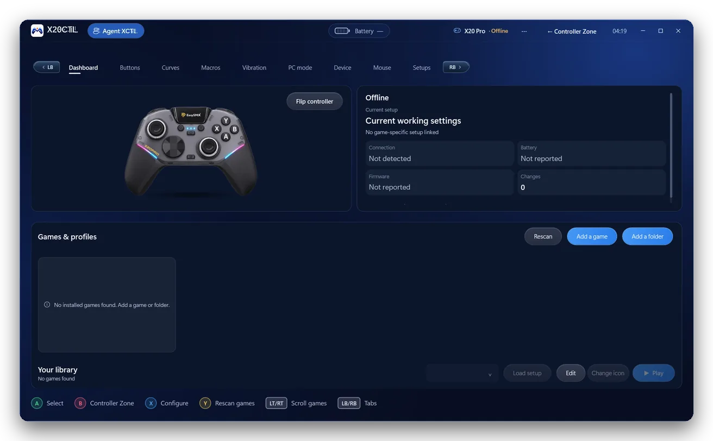</p>

#### Buttons

Pick a button on the controller, then press what it should do. Front and back views are included, plus a showcase of every output a control can send. **Test mapping** lets you feel a change before you keep it, and **All assignments** lists everything you've changed.

<p align="center">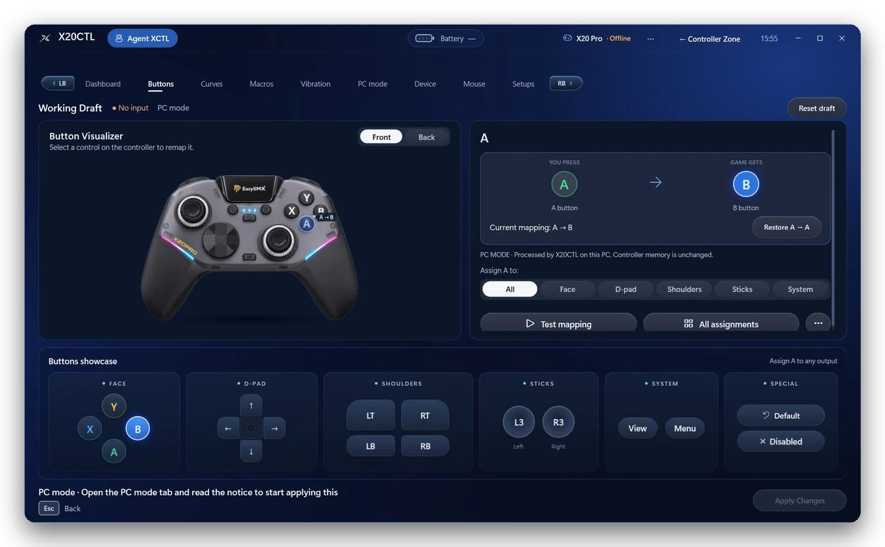</p>

#### Curves

Shape each stick and trigger separately: presets, or your own curve with inner dead zone and outer travel limit. The graph shows the response a game actually gets, and a live dot follows the real stick.

<p align="center">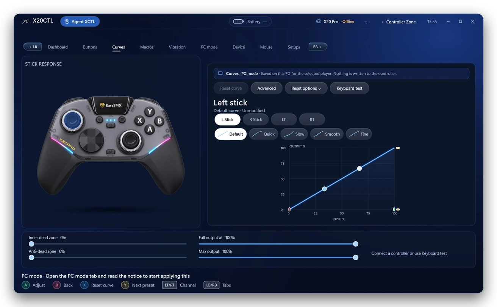</p>

**Advanced** opens the fine stick tools:

- dead zones in 0.1% steps, anti-deadzone and max output;
- a square gate, up/down speed, or pure raw 1:1;
- presets, copy to the other stick, and a table of what the game gets at each push;
- **Measure drift**, which sets each inner dead zone just past how far the stick wanders on its own.

<p align="center">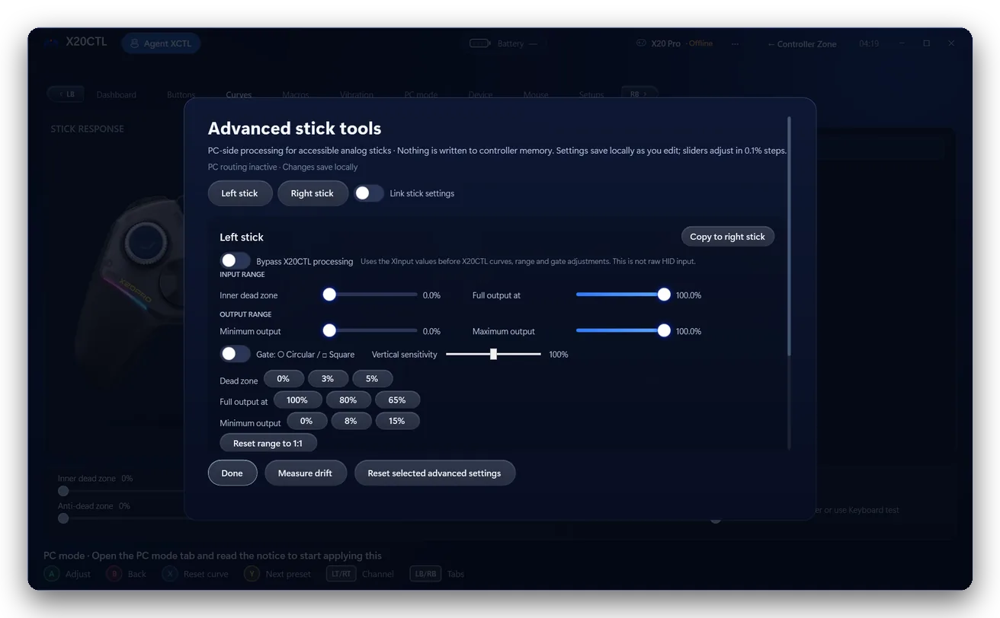</p>

#### Macros

Build sequences for the M back paddles, step by step, on a timeline. Each step holds buttons, stick directions or a pause, with its own timing, and you can record one by playing the moves. The X20 Pro has six paddle slots (M1 to M6).

<p align="center">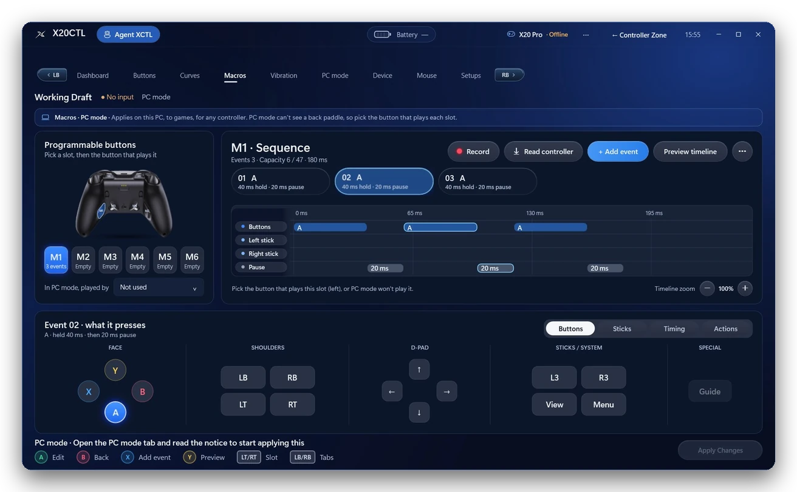</p>

#### Vibration

Set motor strength and watch the preview: each grip lights along its own edge and pulses with the motors. It is a visual preview of your setting, not a reading from the motors. The X20 Pro and the Dune have trigger motors; every other model has two grip motors.

<p align="center">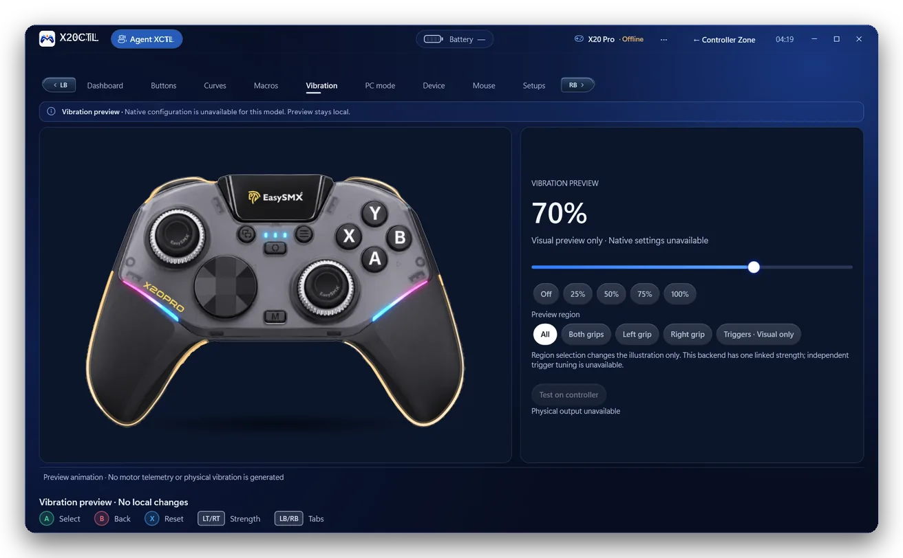</p>

#### PC mode

PC mode gives any controller remaps, turbo, stick and trigger curves and macros on the PC. X20CTL reads the real controller, applies your settings, and hands the result to the game as a virtual Xbox controller while the real one is hidden. Nothing is written to the controller.

PC mode is a tab on every controller's Studio. While it's on, that controller's own **Buttons**, **Curves** and **Macros** tabs edit the PC mode settings, and every change applies right away.

<p align="center">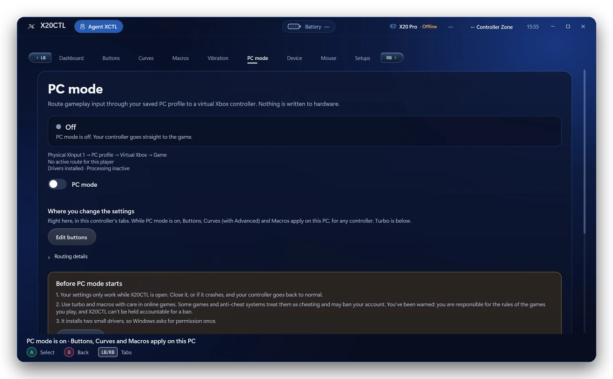</p>

- **Back paddles and macros.** EasySMX paddles don't have a button of their own: each one sends an ordinary button. So in PC mode, each macro slot is played by a real button you pick in the Macros tab, and that button plays the macro instead of its usual job.
- **Up to four controllers at once, each with its own settings** and its own virtual Xbox controller, in the same order.
- **Settings per game.** Give a running game its own settings; X20CTL switches to them while that game is in front, and back to *Every game* otherwise.
- **Hold View + Menu for a second** to switch your settings off mid-game, and again to switch them back on.
- **Share settings** as a file or as a short code to paste in a chat. Only the settings go in, never anything about you or your PC.
- It's on by default but does nothing until you change a setting, and it only works while X20CTL is open.
- The first time, it installs two small drivers by Nefarius: [ViGEmBus](https://github.com/nefarius/ViGEmBus) (the virtual controller) and [HidHide](https://github.com/nefarius/HidHide) (hides the real one). Their official installers are inside the exe, checked against pinned hashes. Remove them any time from Windows Settings → Apps.
- **Turbo and macros can get you banned in online games.** You are responsible for the rules of the games you play.

#### Device

The controller's battery, firmware, hardware revision and transport. Gameplay and configuration are listed as separate connections, along with what X20CTL supports on this model.

<p align="center">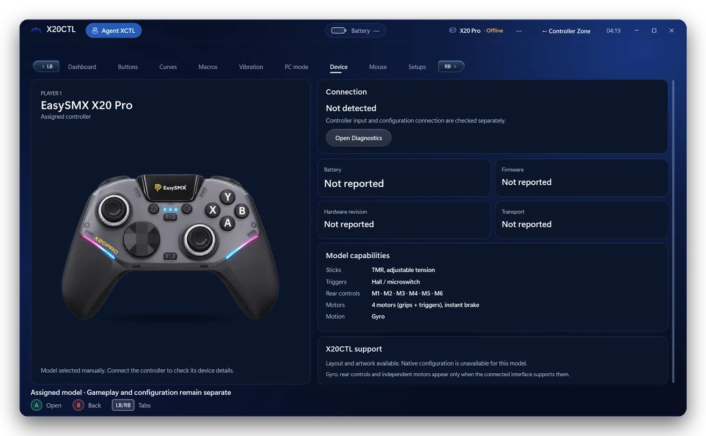</p>

#### Diagnostics

A live, read-only check of the controller:

- **Sticks:** a range trace with its roundness, where each stick rests (drift), and the smallest step it moves in.
- **Triggers:** how far each one travels.
- **Buttons:** every press, with chatter flagged, since a press too short for a finger usually means a worn switch.
- **Report rate:** how many reports a second the controller really sends.

**Copy report** puts the readings on the clipboard for a bug report. **Use as dead zone** puts a stick's measured drift straight into PC mode's dead zone.

<p align="center">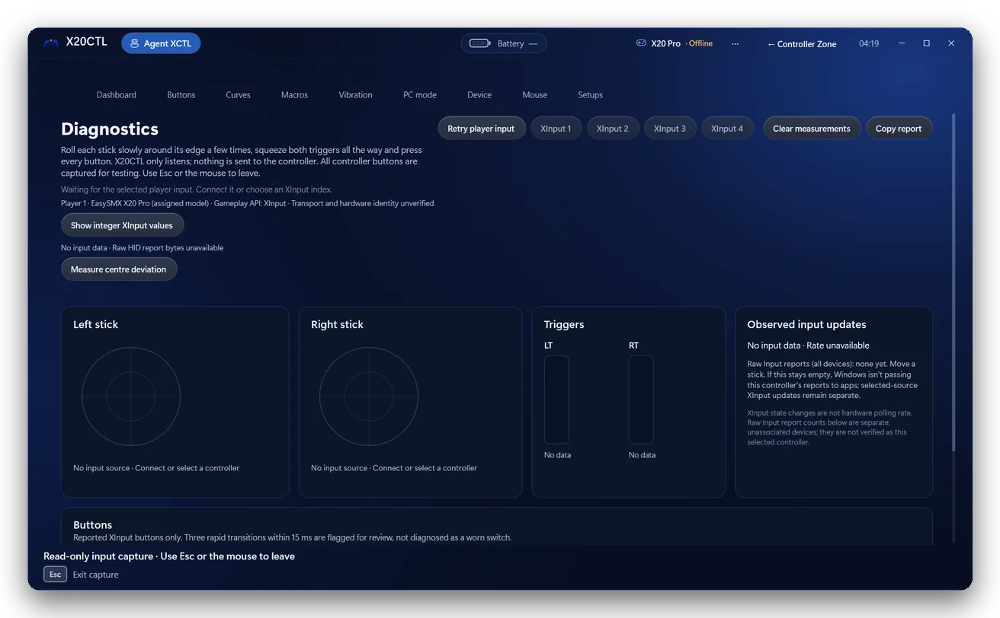</p>

#### Mouse

Use the controller as a mouse around Windows: from the couch, or in a game's launcher. One stick moves the pointer, the other scrolls, and every button does what you pick: clicks, back and forward, Enter, Escape, arrows, the Windows key, Task view, volume, the on-screen keyboard, or a slow pointer while held.

- Switch it on in the tab, from the tray icon, or by holding **View + Y** for a second.
- Speed, acceleration, dead zone, slow-pointer speed and scroll speed are adjustable.
- While it's on, games see a resting controller, so a click never also presses A in a game.
- The idea comes from [Gopher360](https://github.com/Tylemagne/Gopher360); X20CTL's version is written fresh.

<p align="center">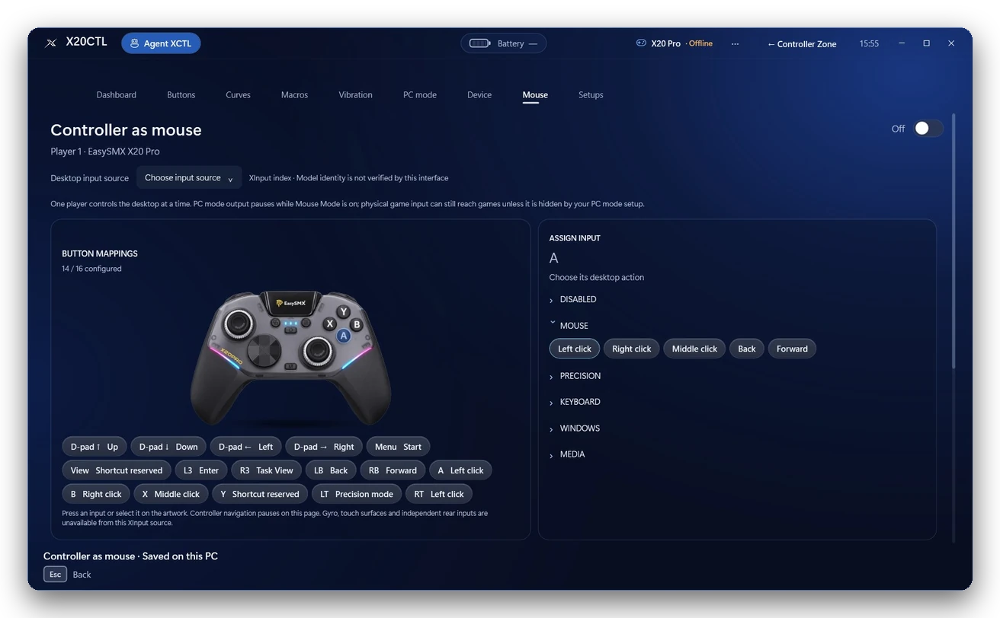</p>

#### Setups

Keep whole-controller setups in a local library: buttons, curves, macros and vibration together. Open, duplicate, rename, export and import them.

<p align="center">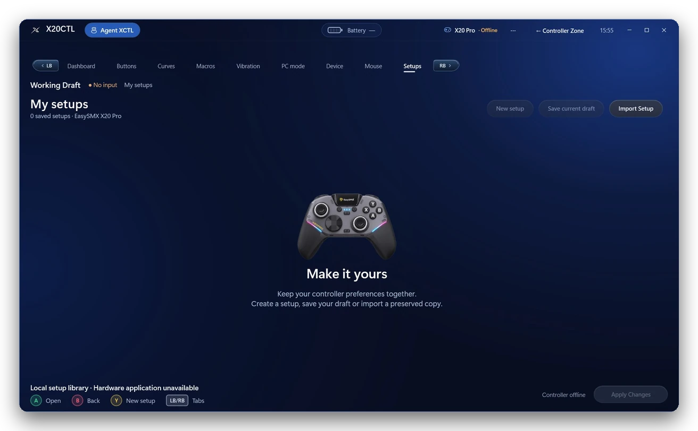</p>

#### Tester

See exactly what Windows receives from the controller: every button, both sticks and both triggers, live, with the front and back views.

<p align="center">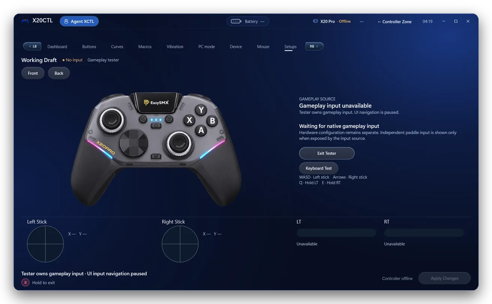</p>

### Tools

Help and extras: PC mode, the Controller Check, Replay Intro, About, Send feedback, Support X20CTL and the GitHub repository, plus switches for update checks and for the opening intro.

<p align="center">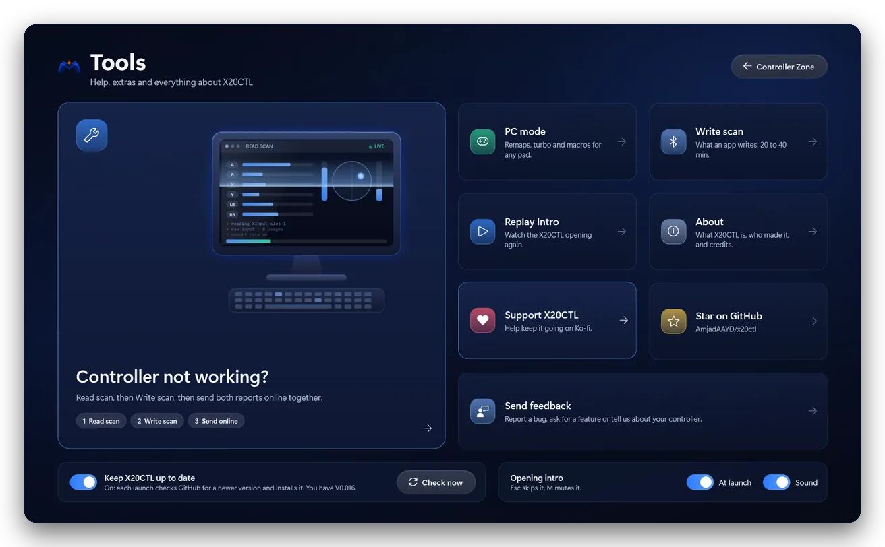</p>

#### Controller Check

Is the controller not working? The Controller Check walks you through every button, stick and trigger, one step at a time. It shows held times, the stick report rate and resolution, battery, button chatter, and what the controller reports to Windows. It then saves a ZIP report to `Documents\X20CTLInputReports`.

It only reads. It never changes settings, lighting, vibration or firmware. Sending the report is your choice: before the scan starts, pick **Scan and send** or **Scan, keep it on this PC**.

<p align="center">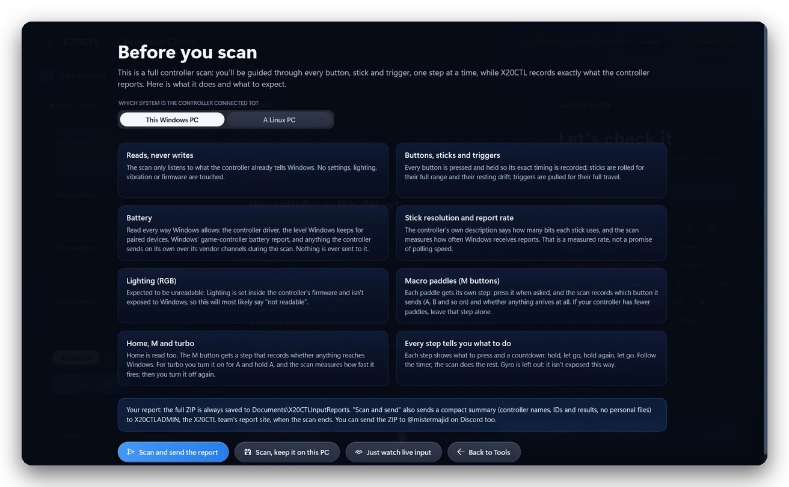</p>

The Controller Check is the **Read scan**. Its partner, the **Write scan**, learns what KeyLinker writes to a controller. You change one setting in KeyLinker on an Android phone or an iPhone while the phone's Bluetooth log records, then open the log here, and you can send the findings to X20CTL. X20CTL shows who the controller says it is, what it offers, and the bytes the app changed. X20CTL sends nothing to the controller. It's slow: plan on 20 to 40 minutes the first time.

Without a phone log, the command line can compare the controller's own settings before and after a change: `x20 state save before.json --label before`, change one setting in the official app and close it, `x20 state save after.json --label after`, then `x20 state diff before.json after.json`. It shows which record and bytes changed, not the messages that changed them.

#### Feedback and About

**Send feedback** goes straight to the X20CTL inbox, and **About** has the credits.

<p align="center">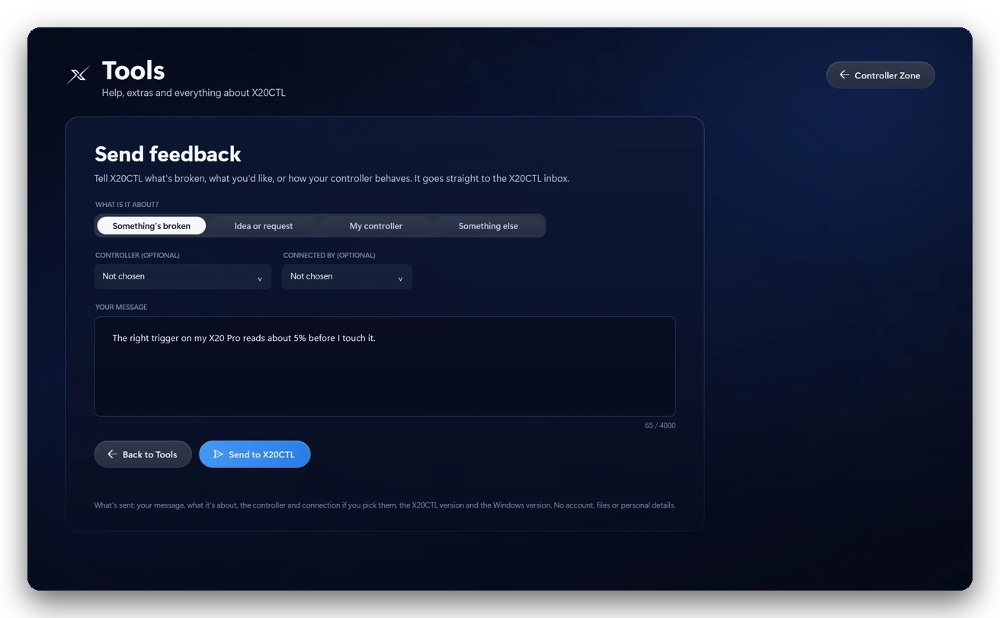</p>

<p align="center">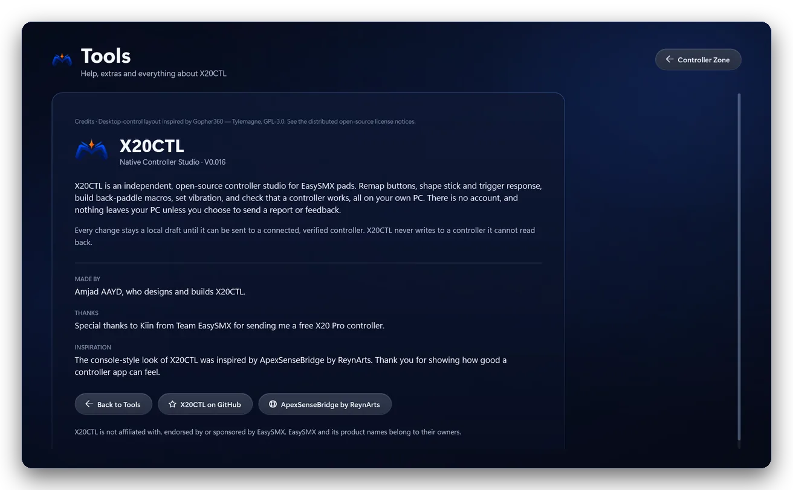</p>

## Supported controllers

| Controller | Status |
|---|---|
| **EasySMX X20** | Verified. Full Studio: buttons, curves, macros (M1–M4), vibration, setups, tester |
| EasySMX X20 Pro | Read-only preview: TMR sticks, six back buttons, four motors including the triggers |
| EasySMX Dune | Read-only preview: TMR sticks, M1–M4, four motors including the triggers |
| EasySMX X15 | Read-only preview |
| EasySMX X10 | Read-only preview |
| EasySMX X05 | Read-only preview |
| EasySMX X05 Pro | Read-only preview |
| EasySMX D10 | Read-only preview |

For a preview model, nothing is written to the controller and nothing is stored as if it had been. A model becomes verified only once its settings can be read back from real hardware. Controller Check reports from owners help get each model there. With [PC mode](#pc-mode) on, every model gets remaps, curves and macros on the PC, since nothing is written to the controller.

## Download

**Windows:** download **[X20CTL-V0.017-windows-x64-setup.exe](https://github.com/AmjadAAYD/x20ctl/releases/download/v0.017/X20CTL-V0.017-windows-x64-setup.exe)** and run it. It installs X20CTL with a Start menu entry and an uninstaller in Windows Apps. To skip installing, take **[X20CTL-V0.017-windows-x64.exe](https://github.com/AmjadAAYD/x20ctl/releases/download/v0.017/X20CTL-V0.017-windows-x64.exe)** instead and run it from anywhere. The first launch unpacks the engine and data into your temp folder, so it takes a moment longer than later launches.

You need Windows 10 or 11 (x64). Everything is bundled: you don't need to install .NET, Python, a browser runtime or an account.

**Code signing:** releases are built on GitHub Actions straight from this repository, and X20CTL has applied for free code signing for open-source projects from the [SignPath Foundation](https://signpath.org). Until that is approved, the exe is **unsigned**, so Windows SmartScreen may warn you. Check the download against the release's `SHA256SUMS.txt`. Never turn off your antivirus to run it.

**Linux:** [X20CTL-V0.017-linux-check.zip](https://github.com/AmjadAAYD/x20ctl/releases/download/v0.017/X20CTL-V0.017-linux-check.zip). The Studio is Windows-only for now; this ZIP contains the Controller Check (`x20ctl-check.py`) and PC mode (`x20ctl-pcmode.py`) as standalone Python 3 scripts. The `x20` command line (`uv run x20 scan`) runs from this repository. A native Linux build of the full Studio is planned.

Every earlier release is on the [releases page](https://github.com/AmjadAAYD/x20ctl/releases). How the version names work: [docs/versions.md](docs/versions.md).

## Local first

- No account. No telemetry. The update check is on by default and you can turn it off with **Keep X20CTL up to date** in Tools. PC mode names its two drivers and asks before it installs them. Your setups, drafts and assignments stay in your user folder.
- Every change is a **local draft** until it can be sent to a connected, verified controller. X20CTL never writes to a controller it cannot read back.
- The game shelf reads only the Steam and Epic launchers' own local files.
- The only uploads are a Controller Check report when you choose **Scan and send**, and feedback when you press **Send to X20CTL**. The [privacy policy](PRIVACY.md) lists exactly what each one contains. External links, such as Support and GitHub, open in your browser and only when you click them.
- X20CTL does not flash firmware.

## Build from source

You need the .NET 10 SDK on Windows:

```powershell
git clone https://github.com/AmjadAAYD/x20ctl.git
cd x20ctl
dotnet build desktop-dotnet\X20Ctl.Product\X20Ctl.Product.csproj -c Release
```

The controller art is generated from the source pictures by `tools/build_native_controller_layers.py`, and the outlines by `tools/build_controller_outlines.py`. The protocol research and the earlier Python and React desktop lines are still in the repository: see [docs/](docs/) and the [protocol reference](docs/01-protocol.md).

## Credits

**Special thanks to Kiin from Team EasySMX** for supplying a free X20 Pro controller. Real hardware is what turns a protocol guess into a verified setting.

The console-style look was inspired by [ApexSenseBridge by Kayn arts (ReynArts)](https://github.com/ReynArts/ApexSenseBridge). The credit is for design inspiration only; no code was taken from it. X20CTL has its own branding, artwork and implementation.

If X20CTL helps you, you can [support it on Ko-fi](https://ko-fi.com/x20ctl), or simply star the repo.

## License

From V0.012 (4.1.0 Preview 3), X20CTL is free software under the **[GNU General Public License v3.0 or later](LICENSE)**. You may use, study, share and change it. If you distribute a modified version, it must stay open under the same licence.

Releases up to and including V0.011 (4.1.0 Preview 2) were published under MIT, and code contributed under MIT keeps its notice ([licenses/](licenses/)). See [NOTICE](NOTICE) for details and the full non-affiliation statement.
