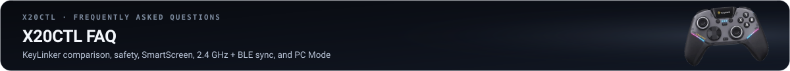

  

Quick answers to the most common questions about X20CTL.

---

### Why use X20CTL instead of the KeyLinker phone app?
- **No phone required:** Configure your controller directly on Windows or Linux without pairing it to Android/iOS every time.
- **Unlocks PC-only features:** Run **Ambient Screen Sync** (LEDs match your monitor), upload custom images and animated GIFs to the X20 Pro `160x80` screen over USB, use **100% offline Agent XCTL**, and run per-game **PC Mode** profiles (Xbox 360 / PS4 emulation, 64-key macros, Controller as Mouse, and 200% rumble boost).
- **Zero bloat:** Available as a single portable `.exe` or standard installer with no background telemetry or cloud account.

### Is X20CTL safe? Does it flash controller firmware?
Yes, it is safe for normal use, and **X20CTL never flashes firmware** and leaves OTA update services untouched. Every hardware write (buttons, curves, macros, lighting) reads the current record first, backs up a checkpoint locally, writes once, and verifies by reading the record back.

### Why does Windows SmartScreen warn when opening the `.exe`?
X20CTL has applied for free open-source code signing through the [SignPath Foundation](https://signpath.org/). Until signing is active, releases are unsigned, so Windows SmartScreen may show a warning on first launch. You can verify any download against `SHA256SUMS.txt` on the [Releases page](https://github.com/AmjadAAYD/x20ctl/releases) instead of disabling your antivirus.

### Can I configure lighting and settings while playing over the 2.4 GHz dongle?
Yes on the **EasySMX X20 Pro**. Keep your PC's Bluetooth turned on (no need to pair the pad in Windows Bluetooth settings): X20CTL automatically uses simultaneous **2.4 GHz dongle (`413D:2131`) + unpaired BLE sync** to push RGB updates, Ambient Screen Sync, and settings while you play.

### How does PC Mode work, and is it safe for online games?
PC Mode creates a virtual Xbox 360 or PlayStation 4 controller via signed Nefarius drivers ([ViGEmBus](https://github.com/nefarius/ViGEmBus) + [HidHide](https://github.com/nefarius/HidHide)) on Windows or `/dev/uinput` on Linux. Your physical controller is hidden from games so there is no double input, and closing X20CTL (or holding **View + Menu**) restores your pad immediately.
- **Anti-cheat notice:** Simple button remaps and curves behave like a standard controller, but **turbo and macros can violate anti-cheat rules in competitive online games**. Always check each game's policy first.

### My controller shows up as `STK-7024X` (`0079:181C`) or isn't detected
Switch the controller back from DirectInput (`STK-7024X`) to **XInput** mode, then check [IF-YOUR-CONTROLLER-ISNT-WORKING.md](../IF-YOUR-CONTROLLER-ISNT-WORKING.md).

### Which EasySMX controllers are supported, and where can I buy one?
- **Full BLE GATT configuration:** EasySMX X20, EasySMX X20 Pro (+ RGB Studio & `160x80` USB screen).
- **PC Mode + Read-only / Experimental:** EasySMX X15, X10, X05 Pro, D10, and Dune 8K.
- **Thinking of buying an EasySMX controller?** Use the [EasySMX referral link (`?ref=X20CTL`)](https://www.easysmx.com/?ref=X20CTL) (10% affiliate commission supports X20CTL development at no extra cost to you).

### How can I support X20CTL?
- Star the [GitHub repository](https://github.com/AmjadAAYD/x20ctl) so more EasySMX owners can find it.
- Support development directly on [Ko-fi](https://ko-fi.com/x20ctl) or shop via the [EasySMX referral link](https://www.easysmx.com/?ref=X20CTL).
